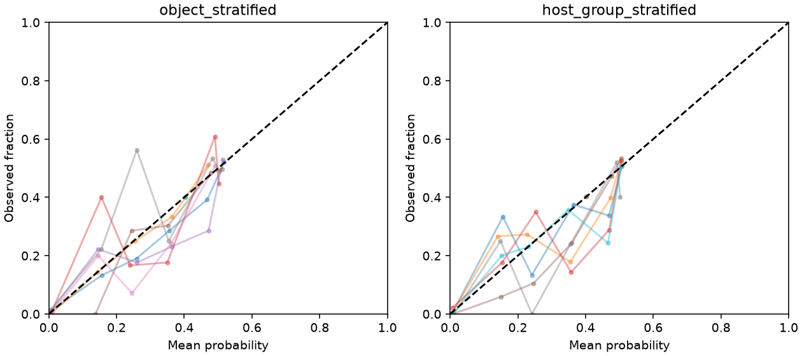
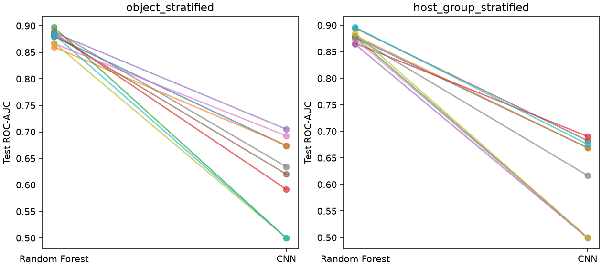
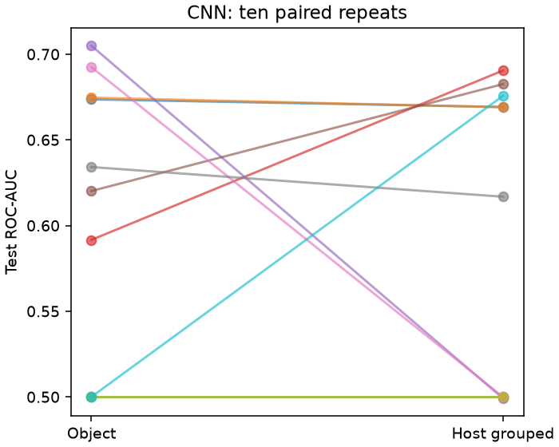
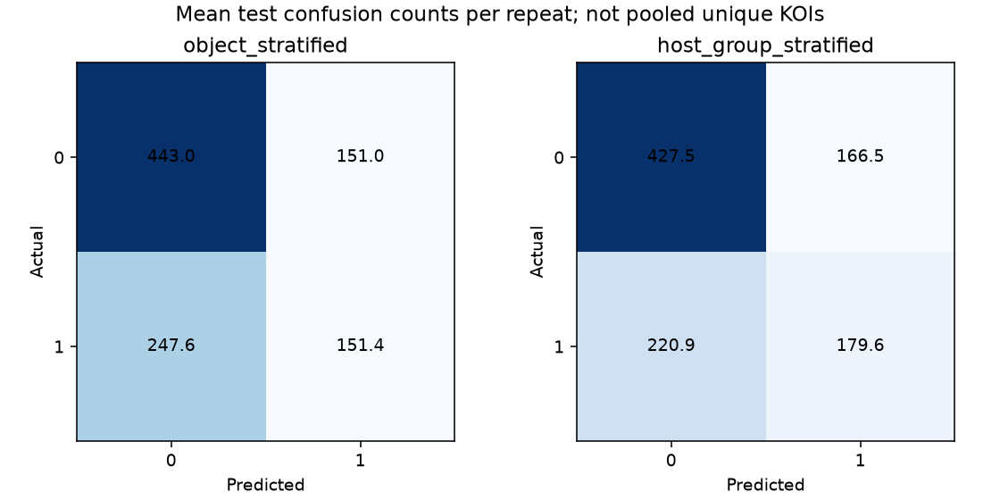
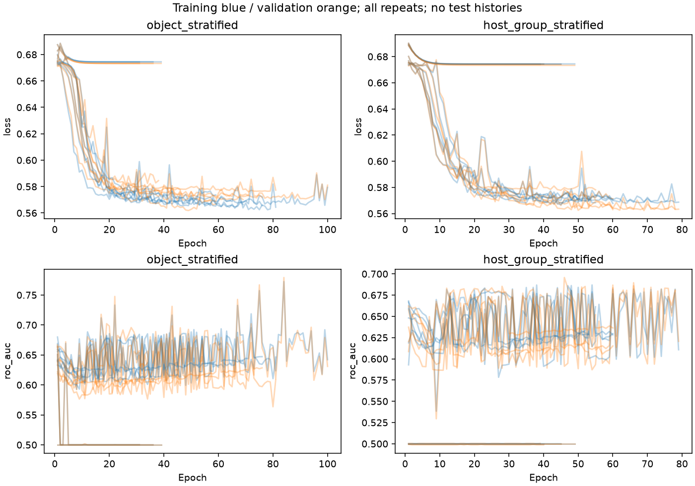
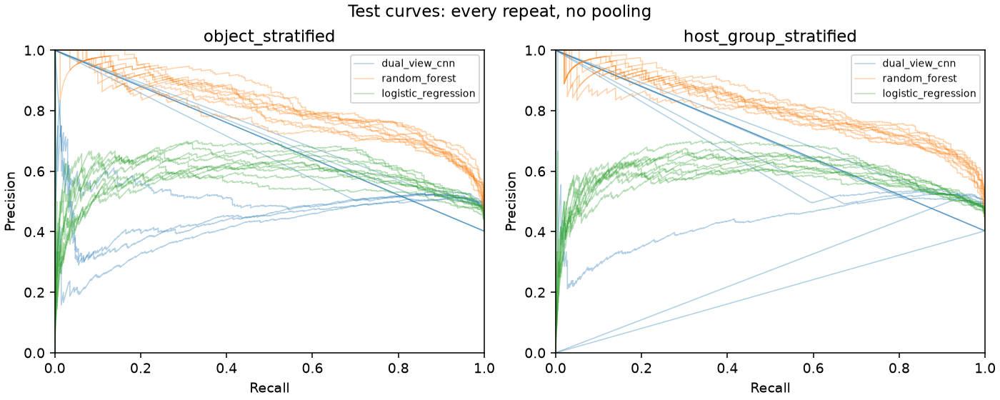
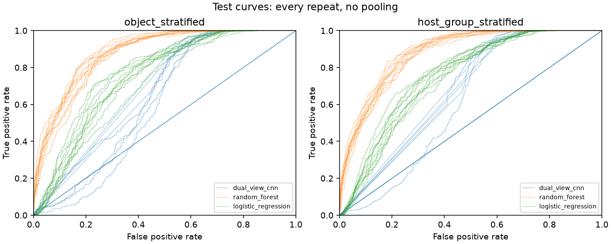

# Stage 5 dual-view CNN report

Status: **certified; 20 scientific fits, replay, offline tests and final artifact consistency verified**. No attribution, tuning, TESS or app integration.

Frozen validation passed: **6,637 KOIs / 5,804 hosts; 6,354 QC passes and 283 QC failures**. All canonical NPZ and 39,822 logical hashes passed. Stage 1 labels, Stage 3 assignments, Stage 4A arrays and Stage 4B artifacts remain unchanged.

A second read-only audit after training reverified all **6,637 canonical NPZ byte hashes**, checked missing/orphan membership, and rechecked frozen metadata and Stage 4B artifacts. [Post-training audit](../data/stage5_infrastructure/post_training_input_audit.json).

## Architecture and environment

Separate global (2000,1) and local (200,1) flux-only branches. Each: Conv16 k5 → pool → Conv32 k5 → pool → flatten. Global pools5 produce2560; local pools2 produce1600. Concatenate4160 → Dense32 ReLU → Dropout0.2 → sigmoid. **138,561 parameters verified programmatically**. No new normalization, augmentation or imputation.

```json
{
  "config_sha256": "e5637804c6c2d6d394ab91db968d532052398cc1245e5384b54e99680f278d91",
  "packages": {
    "h5py": "3.14.0",
    "keras": "3.15.1",
    "numpy": "2.4.6",
    "pandas": "2.3.3",
    "scikit-learn": "1.9.0",
    "scipy": "1.17.1",
    "tensorflow": "2.21.0"
  },
  "python": "3.13.15",
  "source_sha256": {
    "kepler_baselines/__init__.py": "a7392556f3df43207798376bee7e40d498689b6849a9b42a7ea7951c50f20baf",
    "kepler_baselines/inputs.py": "f593c1496b684936ce625618a3f611b820419c8168bb65cd550f31aea7b765bb",
    "kepler_baselines/metrics.py": "d8b34416ad2144c05dafb7d841044553ddae1c77ab95d577ef4ff39bdfe9ac01",
    "kepler_baselines/models.py": "c4a75625d9e6e01945aa20d045ad1281a029669f2a23eff0774c7927f63d8dbd",
    "kepler_baselines/reporting.py": "c22437bb43c6aeca8779b62d89a67ab264fa6fa31f2921b6b98b121e059cc099",
    "kepler_baselines/runner.py": "158c05f1e69ad9260f5cd3e76c990271db2943b452c094ee212be570ef333556",
    "kepler_baselines/runtime.py": "e7eb6fe54d92f3beb253bf705cb40699638a0dd8d665b8d6636e583092692152",
    "kepler_cnn/__init__.py": "aff7b49c38ea2f136e7dc9a137fbb2410afecc1b9f16ef8aa4198249a4c20155",
    "kepler_cnn/artifacts.py": "97bd3d20661ddfac9b94569d4b70796c6879105b5c09201c4b1bbc6f37966077",
    "kepler_cnn/model.py": "71aa92ff99c2d84aa2995bf3a80553e5a900e4cae2e5725ea11b98adc07499de",
    "kepler_cnn/runner.py": "d72064d691c3a80cfa0d35a652bfa9d7479e2a038603175d608c2ab0fbf4b889",
    "scripts/stage5_run_cnn.py": "8c7f02dbe79130e638eb9af69f4cd0373a3cda0383c19820361fcae90aa32b6f"
  }
}
```

Training uses the approved fixed Adam/BCE configuration in [config](../configs/kepler_stage5_cnn_v1.json). Only training rows receive gradients. Validation loss selects the earliest best epoch; test rows are absent from the fitting API. End-of-epoch histories use inference mode with dropout disabled. Optimizer slots reflect the stopping epoch; saved weights reflect the best epoch, and within-fit resume is not supported.

## Determinism

Paired strategies have identical initial-weight hashes. Synthetic training was reproduced exactly; all scientific saved models were reloaded and replayed in a fresh process. Probability tolerance is absolute1e-7, relative0; labels and KOI ordering must match exactly. No independent scientific retraining or cross-platform identity claim. CPU sequential; one numerical/intra/inter-op thread; deterministic operations; oneDNN disabled.

```json
{
  "absolute_tolerance": 1e-07,
  "labels_identical": true,
  "maximum_probability_error": 0.0,
  "metrics_recomputed": 120,
  "models": 20,
  "new_fits": 0,
  "predictions": 132740,
  "relative_tolerance": 0,
  "runtime_seconds": 145.13284799999383,
  "status": "passed"
}
```

## All run outcomes

| model_version | repeat_id | strategy | seed | fit_seconds | model_bytes | best_epoch | best_validation_loss | epoch_cap_reached | status | stopping_epoch |
| --- | --- | --- | --- | --- | --- | --- | --- | --- | --- | --- |
| kepler_dual_view_cnn_v1 | 0 | object_stratified | 1729 | 1160.2487 | 1729431 | 71 | 0.57608926 | False | early_stopped | 81 |
| kepler_dual_view_cnn_v1 | 0 | host_group_stratified | 1729 | 932.66678 | 1729431 | 68 | 0.56303704 | False | early_stopped | 78 |
| kepler_dual_view_cnn_v1 | 1 | object_stratified | 2718 | 477.15074 | 1729431 | 28 | 0.58082098 | False | early_stopped | 38 |
| kepler_dual_view_cnn_v1 | 1 | host_group_stratified | 2718 | 650.16882 | 1729431 | 43 | 0.56946206 | False | early_stopped | 53 |
| kepler_dual_view_cnn_v1 | 2 | object_stratified | 3141 | 490.7344 | 1729431 | 29 | 0.67327034 | False | early_stopped | 39 |
| kepler_dual_view_cnn_v1 | 2 | host_group_stratified | 3141 | 471.68876 | 1729431 | 29 | 0.67397827 | False | early_stopped | 39 |
| kepler_dual_view_cnn_v1 | 3 | object_stratified | 4099 | 568.88831 | 1729431 | 36 | 0.57681334 | False | early_stopped | 46 |
| kepler_dual_view_cnn_v1 | 3 | host_group_stratified | 4099 | 1122.9353 | 1729431 | 69 | 0.56228095 | False | early_stopped | 79 |
| kepler_dual_view_cnn_v1 | 4 | object_stratified | 5279 | 1466.9685 | 1729431 | 99 | 0.57015955 | True | epoch_cap_reached | 100 |
| kepler_dual_view_cnn_v1 | 4 | host_group_stratified | 5279 | 668.43801 | 1729431 | 35 | 0.67405576 | False | early_stopped | 45 |
| kepler_dual_view_cnn_v1 | 5 | object_stratified | 6553 | 1018.1703 | 1729431 | 59 | 0.56871295 | False | early_stopped | 69 |
| kepler_dual_view_cnn_v1 | 5 | host_group_stratified | 6553 | 804.89256 | 1729431 | 45 | 0.57776505 | False | early_stopped | 55 |
| kepler_dual_view_cnn_v1 | 6 | object_stratified | 7919 | 944.70063 | 1729431 | 49 | 0.56185663 | False | early_stopped | 59 |
| kepler_dual_view_cnn_v1 | 6 | host_group_stratified | 7919 | 691.38075 | 1729431 | 30 | 0.67422229 | False | early_stopped | 40 |
| kepler_dual_view_cnn_v1 | 7 | object_stratified | 9341 | 1059.3683 | 1729431 | 66 | 0.56991327 | False | early_stopped | 76 |
| kepler_dual_view_cnn_v1 | 7 | host_group_stratified | 9341 | 1346.6561 | 1729431 | 50 | 0.57006228 | False | early_stopped | 60 |
| kepler_dual_view_cnn_v1 | 8 | object_stratified | 104729 | 1450.9047 | 1729445 | 21 | 0.67327446 | False | early_stopped | 31 |
| kepler_dual_view_cnn_v1 | 8 | host_group_stratified | 104729 | 738.5532 | 1729445 | 39 | 0.67326337 | False | early_stopped | 49 |
| kepler_dual_view_cnn_v1 | 9 | object_stratified | 130363 | 491.90968 | 1729445 | 26 | 0.67326581 | False | early_stopped | 36 |
| kepler_dual_view_cnn_v1 | 9 | host_group_stratified | 130363 | 767.57351 | 1729445 | 50 | 0.56243497 | False | early_stopped | 60 |

Epoch summaries:

| index | best_epoch | stopping_epoch |
| --- | --- | --- |
| count | 20 | 20 |
| mean | 47.1 | 56.65 |
| std | 19.862422 | 18.692174 |
| min | 21 | 31 |
| 25% | 29.75 | 39.75 |
| 50% | 44 | 54 |
| 75% | 60.75 | 70.75 |
| max | 99 | 100 |

## Measured runtime and memory

```json
{
  "fit_seconds_max": 1466.9684812999913,
  "fit_seconds_median": 786.2330310000034,
  "fit_seconds_min": 471.6887602000061,
  "fit_seconds_sum": 17323.99807270008,
  "invocation_seconds": 18189.496753400002,
  "model_bytes": 34588676,
  "process_peak_rss_bytes": 2398846976,
  "reporting_seconds": 8.013483200003975,
  "sampled_phase_peak_rss_bytes": {
    "host_group_stratified/repeat-00": 964419584,
    "host_group_stratified/repeat-01": 1148801024,
    "host_group_stratified/repeat-02": 1312079872,
    "host_group_stratified/repeat-03": 1589829632,
    "host_group_stratified/repeat-04": 1921032192,
    "host_group_stratified/repeat-05": 2214002688,
    "host_group_stratified/repeat-06": 2056478720,
    "host_group_stratified/repeat-07": 2085949440,
    "host_group_stratified/repeat-08": 2106028032,
    "host_group_stratified/repeat-09": 2397032448,
    "input_validation": 755441664,
    "object_stratified/repeat-00": 810582016,
    "object_stratified/repeat-01": 1043755008,
    "object_stratified/repeat-02": 1228754944,
    "object_stratified/repeat-03": 1408401408,
    "object_stratified/repeat-04": 1816076288,
    "object_stratified/repeat-05": 2084155392,
    "object_stratified/repeat-06": 2242736128,
    "object_stratified/repeat-07": 1906094080,
    "object_stratified/repeat-08": 2157064192,
    "object_stratified/repeat-09": 2272313344
  },
  "sampling_interval_seconds": 0.05,
  "scope": "Process working set/RSS including interpreter and feature matrix; family peaks are sampled, not incremental allocations.",
  "size_scope": "Runtime output directory including checksums; compact metadata size reported separately in report; environment excluded.",
  "total_runtime_output_bytes": 49097759,
  "total_scientific_execution_seconds": 18353.87515939999,
  "validation_seconds": 435.8437903000013,
  "post_training_input_audit_seconds": 357.328769300002,
  "reporting_seconds_total": 19.24555799999507,
  "total_timed_stages_including_post_audit_seconds": 18711.203928699993
}
```

Runtime excludes dependency installation, library import before the runner timer, and tests. Total timed stages sums the measured training command, fresh replay, final report generation and (where present) the separate post-training input audit; it is not an end-to-end wall-clock measurement including gaps and tests. Peak RAM is training-process RSS, including TensorFlow and input arrays. Epoch cap is a recorded outcome, not convergence.

## Primary comparison: mean test performance across all ten repeats

| strategy | model | roc_auc | average_precision | brier |
| --- | --- | --- | --- | --- |
| host_group_stratified | dual_view_cnn | 0.60029009 | 0.4595974 | 0.21752384 |
| host_group_stratified | logistic_regression | 0.75266592 | 0.58433574 | 0.20705237 |
| host_group_stratified | random_forest | 0.87933802 | 0.80866031 | 0.14646078 |
| object_stratified | dual_view_cnn | 0.60915779 | 0.46191942 | 0.21384873 |
| object_stratified | logistic_regression | 0.75189046 | 0.58329524 | 0.20751722 |
| object_stratified | random_forest | 0.88019586 | 0.81299261 | 0.14592547 |

These means include every scheduled run, including runs with little probability variation. Random Forest is the principal comparator. Model selection and epoch selection did not use these test results.

Against logistic_regression, CNN test ROC-AUC is higher in 0/20 matched runs, lower in 20/20, and tied in 0/20.

Against random_forest, CNN test ROC-AUC is higher in 0/20 matched runs, lower in 20/20, and tied in 0/20.

## Primary test metrics: every repeat

| model | strategy | repeat_id | partition | track | assigned_count | qc_excluded_count | sample_count | positive_count | negative_count | positive_prevalence | threshold | tn | fp | fn | tp | precision | recall | f1 | precision_undefined | recall_undefined | f1_undefined | accuracy | brier | roc_auc | average_precision | pr_auc_trapezoidal | ranking_undefined_reason |
| --- | --- | --- | --- | --- | --- | --- | --- | --- | --- | --- | --- | --- | --- | --- | --- | --- | --- | --- | --- | --- | --- | --- | --- | --- | --- | --- | --- |
| dual_view_cnn | object_stratified | 0 | test | primary | 993 | 0 | 993 | 399 | 594 | 0.40181269 | 0.5 | 267 | 327 | 45 | 354 | 0.51982379 | 0.88721805 | 0.65555556 | False | False | False | 0.62537764 | 0.20173974 | 0.67364961 | 0.50516715 | 0.67986608 | nan |
| dual_view_cnn | host_group_stratified | 0 | test | primary | 994 | 0 | 994 | 400 | 594 | 0.40241449 | 0.5 | 246 | 348 | 40 | 360 | 0.50847458 | 0.9 | 0.64981949 | False | False | False | 0.60965795 | 0.20652285 | 0.66918771 | 0.50503187 | 0.70713276 | nan |
| dual_view_cnn | object_stratified | 1 | test | primary | 993 | 0 | 993 | 399 | 594 | 0.40181269 | 0.5 | 594 | 0 | 399 | 0 | 0 | 0 | 0 | True | False | False | 0.59818731 | 0.20223593 | 0.6746306 | 0.52447966 | 0.52212362 | nan |
| dual_view_cnn | host_group_stratified | 1 | test | primary | 993 | 0 | 993 | 400 | 593 | 0.40281974 | 0.5 | 278 | 315 | 48 | 352 | 0.52773613 | 0.88 | 0.65979381 | False | False | False | 0.63444109 | 0.20087045 | 0.66903457 | 0.49977533 | 0.67054276 | nan |
| dual_view_cnn | object_stratified | 2 | test | primary | 993 | 0 | 993 | 399 | 594 | 0.40181269 | 0.5 | 594 | 0 | 399 | 0 | 0 | 0 | 0 | True | False | False | 0.59818731 | 0.24036148 | 0.5 | 0.40181269 | 0.70090634 | nan |
| dual_view_cnn | host_group_stratified | 2 | test | primary | 994 | 0 | 994 | 400 | 594 | 0.40241449 | 0.5 | 594 | 0 | 400 | 0 | 0 | 0 | 0 | True | False | False | 0.59758551 | 0.24047709 | 0.5 | 0.40241449 | 0.70120724 | nan |
| dual_view_cnn | object_stratified | 3 | test | primary | 993 | 0 | 993 | 399 | 594 | 0.40181269 | 0.5 | 319 | 275 | 177 | 222 | 0.44668008 | 0.55639098 | 0.49553571 | False | False | False | 0.5448137 | 0.20398058 | 0.59162215 | 0.41317791 | 0.41114857 | nan |
| dual_view_cnn | host_group_stratified | 3 | test | primary | 995 | 0 | 995 | 401 | 594 | 0.40301508 | 0.5 | 259 | 335 | 32 | 369 | 0.52414773 | 0.9201995 | 0.6678733 | False | False | False | 0.63115578 | 0.20397361 | 0.69047289 | 0.52348989 | 0.73364209 | nan |
| dual_view_cnn | object_stratified | 4 | test | primary | 993 | 0 | 993 | 399 | 594 | 0.40181269 | 0.5 | 261 | 333 | 23 | 376 | 0.5303244 | 0.94235589 | 0.67870036 | False | False | False | 0.64149043 | 0.19737767 | 0.7049273 | 0.53361126 | 0.73528046 | nan |
| dual_view_cnn | host_group_stratified | 4 | test | primary | 995 | 0 | 995 | 401 | 594 | 0.40301508 | 0.5 | 594 | 0 | 401 | 0 | 0 | 0 | 0 | True | False | False | 0.59698492 | 0.24059886 | 0.49915825 | 0.40301508 | 0.20150754 | nan |
| dual_view_cnn | object_stratified | 5 | test | primary | 993 | 0 | 993 | 399 | 594 | 0.40181269 | 0.5 | 271 | 323 | 79 | 320 | 0.49766719 | 0.80200501 | 0.61420345 | False | False | False | 0.59516616 | 0.20612556 | 0.62015308 | 0.45351262 | 0.45620446 | nan |
| dual_view_cnn | host_group_stratified | 5 | test | primary | 996 | 0 | 996 | 401 | 595 | 0.40261044 | 0.5 | 309 | 286 | 74 | 327 | 0.53344209 | 0.81546135 | 0.64497041 | False | False | False | 0.63855422 | 0.19726906 | 0.68253316 | 0.50837927 | 0.65752546 | nan |
| dual_view_cnn | object_stratified | 6 | test | primary | 993 | 0 | 993 | 399 | 594 | 0.40181269 | 0.5 | 594 | 0 | 399 | 0 | 0 | 0 | 0 | True | False | False | 0.59818731 | 0.20245301 | 0.6924466 | 0.52377847 | 0.71995009 | nan |
| dual_view_cnn | host_group_stratified | 6 | test | primary | 994 | 0 | 994 | 400 | 594 | 0.40241449 | 0.5 | 594 | 0 | 400 | 0 | 0 | 0 | 0 | True | False | False | 0.59758551 | 0.24047726 | 0.5 | 0.40241449 | 0.70120724 | nan |
| dual_view_cnn | object_stratified | 7 | test | primary | 993 | 0 | 993 | 399 | 594 | 0.40181269 | 0.5 | 342 | 252 | 157 | 242 | 0.48987854 | 0.60651629 | 0.54199328 | False | False | False | 0.58811682 | 0.20349017 | 0.6341485 | 0.46002909 | 0.45828734 | nan |
| dual_view_cnn | host_group_stratified | 7 | test | primary | 996 | 0 | 996 | 401 | 595 | 0.40261044 | 0.5 | 586 | 9 | 395 | 6 | 0.4 | 0.014962594 | 0.028846154 | False | False | False | 0.59437751 | 0.19924321 | 0.6168172 | 0.43718391 | 0.43571202 | nan |
| dual_view_cnn | object_stratified | 8 | test | primary | 993 | 0 | 993 | 399 | 594 | 0.40181269 | 0.5 | 594 | 0 | 399 | 0 | 0 | 0 | 0 | True | False | False | 0.59818731 | 0.24036263 | 0.5 | 0.40181269 | 0.70090634 | nan |
| dual_view_cnn | host_group_stratified | 8 | test | primary | 993 | 0 | 993 | 400 | 593 | 0.40281974 | 0.5 | 593 | 0 | 400 | 0 | 0 | 0 | 0 | True | False | False | 0.59718026 | 0.24055606 | 0.5 | 0.40281974 | 0.70140987 | nan |
| dual_view_cnn | object_stratified | 9 | test | primary | 993 | 0 | 993 | 399 | 594 | 0.40181269 | 0.5 | 594 | 0 | 399 | 0 | 0 | 0 | 0 | True | False | False | 0.59818731 | 0.2403605 | 0.5 | 0.40181269 | 0.70090634 | nan |
| dual_view_cnn | host_group_stratified | 9 | test | primary | 995 | 0 | 995 | 401 | 594 | 0.40301508 | 0.5 | 222 | 372 | 19 | 382 | 0.5066313 | 0.95261845 | 0.66147186 | False | False | False | 0.60703518 | 0.20524996 | 0.67569712 | 0.51144993 | 0.27064509 | nan |

## Run anomalies

| strategy | repeat_id | unique_probabilities | minimum_probability | maximum_probability | constant_predictions | probability_range | at_most_three_probability_values | range_at_most_1e_minus_6 | epoch_cap_reached |
| --- | --- | --- | --- | --- | --- | --- | --- | --- | --- |
| object_stratified | 0 | 2890 | 0 | 0.51882076 | False | 0.51882076 | False | False | False |
| host_group_stratified | 0 | 2440 | 0 | 0.50792676 | False | 0.50792676 | False | False | False |
| object_stratified | 1 | 6526 | 0 | 0.48333296 | False | 0.48333296 | False | False | False |
| host_group_stratified | 1 | 2992 | 0 | 0.50592136 | False | 0.50592136 | False | False | False |
| object_stratified | 2 | 2 | 0.40330583 | 0.40330589 | False | 5.9604645e-08 | True | True | False |
| host_group_stratified | 2 | 2 | 0.40255469 | 0.40255472 | False | 2.9802322e-08 | True | True | False |
| object_stratified | 3 | 6021 | 0 | 0.50385284 | False | 0.50385284 | False | False | False |
| host_group_stratified | 3 | 1985 | 0 | 0.50543398 | False | 0.50543398 | False | False | False |
| object_stratified | 4 | 2053 | 0 | 0.51427525 | False | 0.51427525 | False | False | True |
| host_group_stratified | 4 | 3 | 0.40247676 | 0.4081789 | False | 0.0057021379 | True | False | False |
| object_stratified | 5 | 6489 | 0 | 0.51678228 | False | 0.51678228 | False | False | False |
| host_group_stratified | 5 | 3194 | 5.1911853e-28 | 0.50509298 | False | 0.50509298 | False | False | False |
| object_stratified | 6 | 2584 | 1.6706475e-36 | 0.49380207 | False | 0.49380207 | False | False | False |
| host_group_stratified | 6 | 3 | 0.40285248 | 0.40716472 | False | 0.004312247 | True | False | False |
| object_stratified | 7 | 6556 | 0 | 0.52657771 | False | 0.52657771 | False | False | False |
| host_group_stratified | 7 | 6547 | 0 | 0.51424968 | False | 0.51424968 | False | False | False |
| object_stratified | 8 | 3 | 0.0052821301 | 0.40365049 | False | 0.39836836 | True | False | False |
| host_group_stratified | 8 | 2 | 0.40256631 | 0.40256637 | False | 5.9604645e-08 | True | True | False |
| object_stratified | 9 | 2 | 0.40292794 | 0.40292799 | False | 5.9604645e-08 | True | True | False |
| host_group_stratified | 9 | 1810 | 0 | 0.50529569 | False | 0.50529569 | False | False | False |

Exactly constant probabilities occur in 0/20 runs; 7/20 have only two or three distinct values, and 4/20 have a full-cohort probability range strictly below 1e-7 (also satisfying the existing 1e-6 diagnostic flag). These descriptive flags were added for anomaly reporting after fitting; they do not exclude runs or change predictions, metrics or thresholds. No corrective refits or seed selection were performed. ROC-AUC in nearly tied outputs can be sensitive to minute numerical differences; the saved fixed-batch results are preserved exactly rather than rounded or repaired. The mechanism of limited discrimination has not been established. Differences between split strategies can reflect optimization outcomes as well as cohort composition and must not automatically be attributed to host leakage.

## Primary test repeat summaries

| model | strategy | partition | track | metric | count | mean | median | std | min | max | range |
| --- | --- | --- | --- | --- | --- | --- | --- | --- | --- | --- | --- |
| dual_view_cnn | host_group_stratified | test | primary | accuracy | 10 | 0.61045579 | 0.60231034 | 0.017490143 | 0.59437751 | 0.63855422 | 0.044176707 |
| dual_view_cnn | host_group_stratified | test | primary | average_precision | 10 | 0.4595974 | 0.46847962 | 0.054054048 | 0.40241449 | 0.52348989 | 0.1210754 |
| dual_view_cnn | host_group_stratified | test | primary | brier | 10 | 0.21752384 | 0.20588641 | 0.019982498 | 0.19726906 | 0.24059886 | 0.0433298 |
| dual_view_cnn | host_group_stratified | test | primary | f1 | 10 | 0.3312775 | 0.33690828 | 0.34327898 | 0 | 0.6678733 | 0.6678733 |
| dual_view_cnn | host_group_stratified | test | primary | pr_auc_trapezoidal | 10 | 0.57805321 | 0.685875 | 0.19939845 | 0.20150754 | 0.73364209 | 0.53213456 |
| dual_view_cnn | host_group_stratified | test | primary | precision | 10 | 0.30004318 | 0.45331565 | 0.26092981 | 0 | 0.53344209 | 0.53344209 |
| dual_view_cnn | host_group_stratified | test | primary | recall | 10 | 0.44832419 | 0.41521197 | 0.47068559 | 0 | 0.95261845 | 0.95261845 |
| dual_view_cnn | host_group_stratified | test | primary | roc_auc | 10 | 0.60029009 | 0.64292589 | 0.088650918 | 0.49915825 | 0.69047289 | 0.19131464 |
| dual_view_cnn | object_stratified | test | primary | accuracy | 10 | 0.59859013 | 0.59818731 | 0.024882249 | 0.5448137 | 0.64149043 | 0.096676737 |
| dual_view_cnn | object_stratified | test | primary | average_precision | 10 | 0.46191942 | 0.45677086 | 0.055816018 | 0.40181269 | 0.53361126 | 0.13179857 |
| dual_view_cnn | object_stratified | test | primary | brier | 10 | 0.21384873 | 0.20373537 | 0.018426302 | 0.19737767 | 0.24036263 | 0.042984962 |
| dual_view_cnn | object_stratified | test | primary | f1 | 10 | 0.29859884 | 0.24776786 | 0.3189101 | 0 | 0.67870036 | 0.67870036 |
| dual_view_cnn | object_stratified | test | primary | pr_auc_trapezoidal | 10 | 0.60855797 | 0.69038621 | 0.12968789 | 0.41114857 | 0.73528046 | 0.32413189 |
| dual_view_cnn | object_stratified | test | primary | precision | 10 | 0.2484374 | 0.22334004 | 0.2627686 | 0 | 0.5303244 | 0.5303244 |
| dual_view_cnn | object_stratified | test | primary | recall | 10 | 0.37944862 | 0.27819549 | 0.41580216 | 0 | 0.94235589 | 0.94235589 |
| dual_view_cnn | object_stratified | test | primary | roc_auc | 10 | 0.60915779 | 0.62715079 | 0.082565738 | 0.5 | 0.7049273 | 0.2049273 |

## CNN object minus grouped: paired results

| model | partition | track | metric | count | mean | median | std | min | max | range |
| --- | --- | --- | --- | --- | --- | --- | --- | --- | --- | --- |
| dual_view_cnn | test | primary | accuracy | 10 | -0.011865662 | -0.0028294471 | 0.035887082 | -0.086342083 | 0.044505508 | 0.13084759 |
| dual_view_cnn | test | primary | average_precision | 10 | 0.0023220234 | -0.00023326172 | 0.081692967 | -0.11031198 | 0.13059618 | 0.24090816 |
| dual_view_cnn | test | primary | brier | 10 | -0.0036751164 | -5.4321166e-05 | 0.022442191 | -0.043221193 | 0.035110534 | 0.078331727 |
| dual_view_cnn | test | primary | f1 | 10 | -0.032678667 | 0 | 0.42384849 | -0.66147186 | 0.67870036 | 1.3401722 |
| dual_view_cnn | test | primary | pr_auc_trapezoidal | 10 | 0.030504758 | -0.00040221186 | 0.26434365 | -0.32249352 | 0.53377292 | 0.85626645 |
| dual_view_cnn | test | primary | precision | 10 | -0.051605783 | 0 | 0.29912486 | -0.52773613 | 0.5303244 | 1.0580605 |
| dual_view_cnn | test | primary | recall | 10 | -0.068875568 | -0.0063909774 | 0.57784225 | -0.95261845 | 0.94235589 | 1.8949743 |
| dual_view_cnn | test | primary | roc_auc | 10 | 0.0088676945 | 0.0022309509 | 0.11712959 | -0.17569712 | 0.20576905 | 0.38146617 |

## CNN minus each baseline

| baseline | strategy | partition | track | metric | count | mean | median | std | min | max | range |
| --- | --- | --- | --- | --- | --- | --- | --- | --- | --- | --- | --- |
| logistic_regression | host_group_stratified | test | primary | accuracy | 10 | -0.084564222 | -0.080359629 | 0.028478326 | -0.13682093 | -0.04632427 | 0.090496656 |
| logistic_regression | host_group_stratified | test | primary | average_precision | 10 | -0.12473834 | -0.10193643 | 0.063802893 | -0.22315187 | -0.045888389 | 0.17726348 |
| logistic_regression | host_group_stratified | test | primary | brier | 10 | 0.010471477 | 0.002852042 | 0.022509318 | -0.021252664 | 0.044175829 | 0.065428492 |
| logistic_regression | host_group_stratified | test | primary | f1 | 10 | -0.29945364 | -0.29145893 | 0.34766817 | -0.66412214 | 0.052606702 | 0.71672884 |
| logistic_regression | host_group_stratified | test | primary | pr_auc_trapezoidal | 10 | -0.0043592471 | 0.086410475 | 0.19103108 | -0.38909809 | 0.14489569 | 0.53399378 |
| logistic_regression | host_group_stratified | test | primary | precision | 10 | -0.31649026 | -0.15298757 | 0.27389831 | -0.6761658 | -0.07422947 | 0.60193633 |
| logistic_regression | host_group_stratified | test | primary | recall | 10 | -0.1978591 | -0.23441397 | 0.47032226 | -0.66084788 | 0.29177057 | 0.95261845 |
| logistic_regression | host_group_stratified | test | primary | roc_auc | 10 | -0.15237582 | -0.10199984 | 0.094564648 | -0.28522306 | -0.057524539 | 0.22769853 |
| logistic_regression | object_stratified | test | primary | accuracy | 10 | -0.096173212 | -0.090130916 | 0.044866783 | -0.19133938 | -0.032225579 | 0.1591138 |
| logistic_regression | object_stratified | test | primary | average_precision | 10 | -0.12137582 | -0.1063247 | 0.072162742 | -0.22845452 | -0.014165684 | 0.21428884 |
| logistic_regression | object_stratified | test | primary | brier | 10 | 0.0063315052 | -0.0013786208 | 0.024799244 | -0.02226335 | 0.048982105 | 0.071245455 |
| logistic_regression | object_stratified | test | primary | f1 | 10 | -0.33152164 | -0.35572658 | 0.30498985 | -0.68856448 | 0.030994152 | 0.71955863 |
| logistic_regression | object_stratified | test | primary | pr_auc_trapezoidal | 10 | 0.026995908 | 0.08753027 | 0.13533039 | -0.19785516 | 0.18401978 | 0.38187494 |
| logistic_regression | object_stratified | test | primary | precision | 10 | -0.3657484 | -0.38226611 | 0.26634359 | -0.66903073 | -0.065702527 | 0.60332821 |
| logistic_regression | object_stratified | test | primary | recall | 10 | -0.26917293 | -0.32330827 | 0.38278407 | -0.70927318 | 0.2406015 | 0.94987469 |
| logistic_regression | object_stratified | test | primary | roc_auc | 10 | -0.14273267 | -0.11413952 | 0.095753371 | -0.29157068 | -0.0098816064 | 0.28168907 |
| random_forest | host_group_stratified | test | primary | accuracy | 10 | -0.17938763 | -0.18008048 | 0.018862831 | -0.20502513 | -0.14472362 | 0.060301508 |
| random_forest | host_group_stratified | test | primary | average_precision | 10 | -0.34906291 | -0.33458715 | 0.049280769 | -0.41641702 | -0.26827942 | 0.1481376 |
| random_forest | host_group_stratified | test | primary | brier | 10 | 0.071063059 | 0.061676217 | 0.019352451 | 0.051474378 | 0.098060176 | 0.046585799 |
| random_forest | host_group_stratified | test | primary | f1 | 10 | -0.41328836 | -0.41651036 | 0.33461904 | -0.75296912 | -0.065698979 | 0.68727014 |
| random_forest | host_group_stratified | test | primary | pr_auc_trapezoidal | 10 | -0.2301729 | -0.13069831 | 0.200162 | -0.59686382 | -0.057681273 | 0.53918255 |
| random_forest | host_group_stratified | test | primary | precision | 10 | -0.42939021 | -0.29533136 | 0.25231839 | -0.7373494 | -0.17998071 | 0.55736868 |
| random_forest | host_group_stratified | test | primary | recall | 10 | -0.31247257 | -0.35127494 | 0.46104209 | -0.7925 | 0.17456359 | 0.96706359 |
| random_forest | host_group_stratified | test | primary | roc_auc | 10 | -0.27904793 | -0.24053913 | 0.085754103 | -0.38502951 | -0.17539695 | 0.20963257 |
| random_forest | object_stratified | test | primary | accuracy | 10 | -0.19264854 | -0.18277946 | 0.030788016 | -0.24874119 | -0.16213494 | 0.086606244 |
| random_forest | object_stratified | test | primary | average_precision | 10 | -0.35107319 | -0.37195723 | 0.067041715 | -0.42879237 | -0.24771086 | 0.18108151 |
| random_forest | object_stratified | test | primary | brier | 10 | 0.067923252 | 0.059956699 | 0.019753125 | 0.050291646 | 0.1024772 | 0.052185551 |
| random_forest | object_stratified | test | primary | f1 | 10 | -0.4463714 | -0.48199857 | 0.31063388 | -0.77791411 | -0.074480301 | 0.70343381 |
| random_forest | object_stratified | test | primary | pr_auc_trapezoidal | 10 | -0.20406179 | -0.1342791 | 0.13125561 | -0.39912305 | -0.066399771 | 0.33272328 |
| random_forest | object_stratified | test | primary | precision | 10 | -0.48335917 | -0.49385184 | 0.24782385 | -0.76201923 | -0.21517621 | 0.54684302 |
| random_forest | object_stratified | test | primary | recall | 10 | -0.37969925 | -0.46365915 | 0.41694876 | -0.79448622 | 0.20050125 | 0.99498747 |
| random_forest | object_stratified | test | primary | roc_auc | 10 | -0.27103807 | -0.25938795 | 0.086720456 | -0.39704058 | -0.17417281 | 0.22286778 |

Per-repeat differences are in [baseline_comparisons.csv](../data/stage5/baseline_comparisons.csv). Random Forest is the principal comparator. Negative Brier differences favour the CNN. Signed and absolute split-sensitivity contrasts are in [split_sensitivity_comparison.csv](../data/stage5/split_sensitivity_comparison.csv).

## QC-pass sensitivity

| model | strategy | partition | track | metric | count | mean | median | std | min | max | range |
| --- | --- | --- | --- | --- | --- | --- | --- | --- | --- | --- | --- |
| dual_view_cnn | host_group_stratified | test | qc_pass | accuracy | 10 | 0.6026754 | 0.59646154 | 0.021183621 | 0.57789474 | 0.63427377 | 0.056379035 |
| dual_view_cnn | host_group_stratified | test | qc_pass | average_precision | 10 | 0.46777114 | 0.47377903 | 0.052062897 | 0.41020191 | 0.53018343 | 0.11998152 |
| dual_view_cnn | host_group_stratified | test | qc_pass | brier | 10 | 0.22053623 | 0.20886623 | 0.019187663 | 0.20157542 | 0.24315256 | 0.041577136 |
| dual_view_cnn | host_group_stratified | test | qc_pass | f1 | 10 | 0.33396945 | 0.33987715 | 0.34606441 | 0 | 0.67279412 | 0.67279412 |
| dual_view_cnn | host_group_stratified | test | qc_pass | pr_auc_trapezoidal | 10 | 0.58299505 | 0.69023063 | 0.19975688 | 0.20628272 | 0.73722263 | 0.5309399 |
| dual_view_cnn | host_group_stratified | test | qc_pass | precision | 10 | 0.30315528 | 0.45606469 | 0.26383831 | 0 | 0.5397351 | 0.5397351 |
| dual_view_cnn | host_group_stratified | test | qc_pass | recall | 10 | 0.44896941 | 0.41708543 | 0.47125716 | 0 | 0.95238095 | 0.95238095 |
| dual_view_cnn | host_group_stratified | test | qc_pass | roc_auc | 10 | 0.59417357 | 0.629644 | 0.084007774 | 0.49910873 | 0.68124284 | 0.1821341 |
| dual_view_cnn | object_stratified | test | qc_pass | accuracy | 10 | 0.59105316 | 0.58761759 | 0.026902247 | 0.54240838 | 0.64232804 | 0.099919665 |
| dual_view_cnn | object_stratified | test | qc_pass | average_precision | 10 | 0.47013118 | 0.46272371 | 0.053999707 | 0.41041667 | 0.54339358 | 0.13297691 |
| dual_view_cnn | object_stratified | test | qc_pass | brier | 10 | 0.21702346 | 0.20764516 | 0.017833439 | 0.20091284 | 0.24359448 | 0.042681641 |
| dual_view_cnn | object_stratified | test | qc_pass | f1 | 10 | 0.30254796 | 0.25198638 | 0.32305264 | 0 | 0.68819188 | 0.68819188 |
| dual_view_cnn | object_stratified | test | qc_pass | pr_auc_trapezoidal | 10 | 0.61433643 | 0.69541503 | 0.12946981 | 0.41910622 | 0.74127807 | 0.32217185 |
| dual_view_cnn | object_stratified | test | qc_pass | precision | 10 | 0.25290161 | 0.22839506 | 0.26745834 | 0 | 0.54215116 | 0.54215116 |
| dual_view_cnn | object_stratified | test | qc_pass | recall | 10 | 0.3815067 | 0.28101266 | 0.41756609 | 0 | 0.94191919 | 0.94191919 |
| dual_view_cnn | object_stratified | test | qc_pass | roc_auc | 10 | 0.60242331 | 0.61220695 | 0.07870812 | 0.5 | 0.69567257 | 0.19567257 |

Identical fitted models and probabilities; no QC-only refitting. Denominators/exclusions remain in metrics.csv.

## Calibration and secondary diagnostics

Brier scores above and [ten-bin calibration table](../data/stage5/calibration_bins.csv) use unchanged Stage 4B definitions. No calibrator or threshold optimization. Host seen/unseen results remain [secondary only](../data/stage5/host_diagnostic.csv).

## Figures















## Interpretation limits

All ten repeats are retained. Repeats overlap; summaries are descriptive and no independence-based significance claims are made. Differences compare split protocols, not a causal leakage effect. Better prediction alone cannot prove morphology learning; attribution and controlled morphology analysis remain deferred to separately reviewed Stage 5A/5.1.

## Verification, warnings and hashes

Offline suite: **140 passed, 0 skipped**, no errors/failures; network tests excluded. `git diff --check` passed. Epoch caps: 1/20. No non-finite or integrity/replay failures occurred in scientific fitting.

| artifact | sha256 |
| --- | --- |
| baseline_comparison_summary.csv | `88867e06c26e9cf66b9c0429c7b738ae9878f672d69280a935c7931c6c9aa042` |
| baseline_comparisons.csv | `9798411b891e9b79f565ae59dd2226dea1e7da88d3bd4bac3a27f856727af901` |
| calibration_bins.csv | `748c338f091c76ab276425e7110977f446e315d0162a1fa7f2826277aa45d46d` |
| certification.json | `655babb670a21a801a9dfff8f6cd57c3538149ff46467b21f3b4a34bad2d5fdc` |
| checksums.sha256 | `73fe54e8aa520190b390091256fb8b41e7b29c84966bc48b0e0598512c2d4340` |
| figures/calibration.png | `f9066594ebae8c9ee42dd03fed2bb8ad43c98cc3c36f115fc371ccd84db57967` |
| figures/cnn_rf_pairs.png | `b85974f72f275d8d214b3dea8452d3bea7ad0ba89c9c9bc09f5e2b7c1f0fa011` |
| figures/cnn_split_pairs.png | `e06c7ec1fe5e73b3951be071de68533cc85951e370e1d74a7c7ddd2d2cc834e8` |
| figures/confusion_summary.png | `21a2d87d988b5b42e5976f799c46070b023083d0fcd69cbb7aa3a4de39f743b6` |
| figures/learning_curves.png | `56bce11d97fe578c2f58c2fdf2e879d69712ee076b55feb94b6911095f31bc2e` |
| figures/precision_recall_comparison.png | `b3f9da5aa377381154419abe5f9918758cc629f7a508b6dc1d2cbf28b92d371d` |
| figures/roc_comparison.png | `eb2fcd97ba3616031061eb0a1d7d79896202b780921ae03f435991d3ef128485` |
| host_diagnostic.csv | `f21c809c78022ba6eebf95f5dc7fbfe4dd8a3da37ce190a8fc88ba0df41efee6` |
| input_validation.json | `da8cab7f1c6050fd4ac6b3a1d8835b4da61683ab3b63db7dde0f50e63126bbac` |
| metrics.csv | `27a675448dccd58e641cb7481bcce0d5af91e0a9ec345ab17b1a609b3dcfbe9f` |
| paired_differences.csv | `fdec0e260a29ba6ac4e52cfe7e78867c74fb52db5c7cde89f118029537b337b2` |
| paired_summary.csv | `f3da60ae9dd84317ad13e35ed3e98da5b2a7628d79300c25037f0a7461eb7a0e` |
| prediction_diagnostics.csv | `819f3e8b6629253f1356db35e688a585fcd15d1aedaabf48ebae86394afa5565` |
| prediction_verification.json | `9d006f3d8eab5e0ed6746537027bf3f9d27f24a8d41a83e9560aa3b5e33f848e` |
| provenance.json | `9b76260c7bf1bc566af5c90336b62fe9b9e54ee7eb4dfe9a0c6b4f321e73b293` |
| repeat_summary.csv | `bef379507c00bbbdd4b4321e256cba61cd97860f0505e925f3d3870a3a24972d` |
| run_manifest.json | `370557be035f1bebdce52abf52147c3cb229d51d13c1fb241124f8b18243a8ae` |
| run_outcomes.csv | `014a551484794d87e7d8088cd406e1f2c7461871f11d07bd5bb95c0f7a211b6f` |
| runtime.json | `9a64f5c4402f1e6b9705fe5b0902ee93e55b58b7b56732b86140e2f1b07b79b5` |
| runtime_checksums.sha256 | `87887a9fbdce7fcf17feb68d3618688f4d36eebcdcbcc974459c53e3cbedd7fc` |
| split_sensitivity_comparison.csv | `9e89f2bcf2e5d8aa5609337752f9730ca6254979bad159b781a08bba0f1d61e5` |

Every model/prediction/history/manifest hash is in the runtime [checksum manifest](../data/stage5_runtime/cnn_v1/checksums.sha256); per-run manifests also record initial-weight hashes. Infrastructure emitted dependency DeprecationWarnings from gast AST annotation handling and Keras NumPy conversion; these did not fail the tests. TensorFlow also emitted a reset_default_graph deprecation notice and a native-Windows GPU-unavailable notice; this experiment intentionally uses CPU.

Total Stage 5 artifact bytes (runtime + compact metadata, excluding this report and environment): 51173232.

## Files created/modified

Created: configs/kepler_stage5_cnn_v1.json, configs/kepler_stage5_environment_lock.txt, kepler_cnn/__init__.py, kepler_cnn/model.py, kepler_cnn/artifacts.py, kepler_cnn/runner.py, scripts/stage5_run_cnn.py, scripts/stage5_report.py, scripts/stage5_finish.ps1, tests/test_stage5_cnn.py, docs/kepler_stage5_cnn.md, docs/kepler_stage5_report.md, data/stage5_infrastructure/passed.json, data/stage5_infrastructure/post_training_input_audit.json, and Stage 5 artifact files listed individually in the two checksum manifests. Modified: .gitignore, pyproject.toml, README.md. Stage 4B changes already present before this task were retained. Isolated environment/bootstrap/test scratch are ignored operational files.

No automatic commit. Stop for review.

## Final certification and commit scope

The finalizer checked all 20 histories and per-run manifests, all 132,740 saved prediction rows, 120 metric rows, 1,200 calibration rows and 1,920 baseline-comparison rows. Frozen metadata, baseline artifacts and recorded source hashes match. Existing passed model replay, offline tests and canonical-array audit were reused; no expensive work or scientific fit was repeated. See [certification.json](../data/stage5/certification.json).

Files created in this finalization: `scripts/stage5_finalize.py`, `data/stage5/certification.json`, `data/stage5/runtime_checksums.sha256`. Files modified: `data/stage5/provenance.json`, `data/stage5/checksums.sha256`, `docs/kepler_stage5_report.md`. Scientific results, histories, models, predictions, figures, runtime measurements and scientific configuration were unchanged.

Recommended commits: (1) certified Stage 4B implementation/results already present in the worktree, if not committed; (2) Stage 5 implementation/configuration/environment lock/tests and README/package/ignore integration; (3) Stage 5 compact results, infrastructure evidence, report and final certification. Split shared README/pyproject/.gitignore hunks by stage. Keep `.venv/`, bootstrap/test scratch and `data/stage5_runtime/` ignored. Commit the compact runtime checksum manifest; retain the actual model/prediction files separately at their current location. No commit was made. Stop for review.
