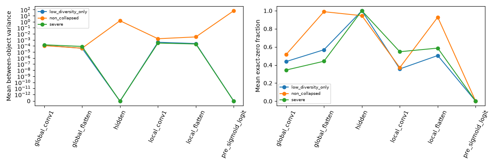
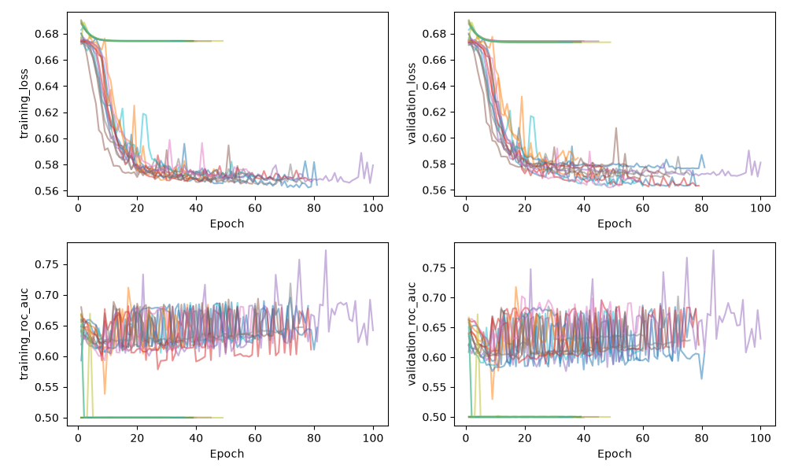
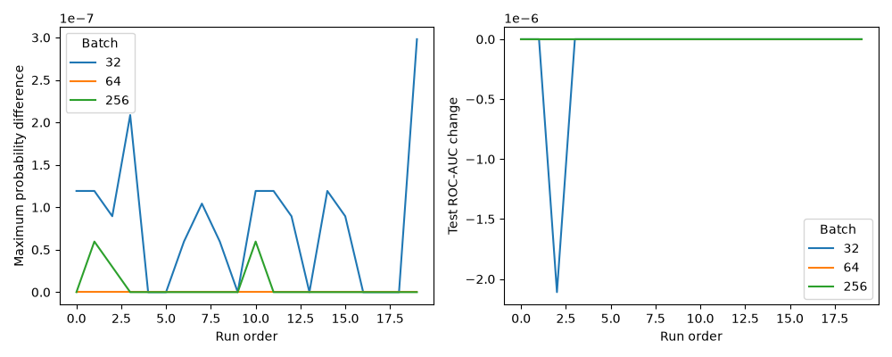
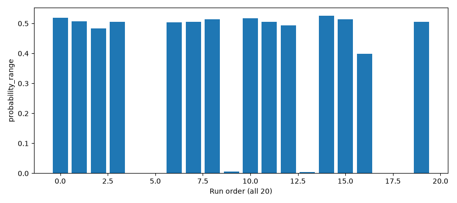

# Stage 5A failure analysis

**Status: finalized; existing diagnostics validated for all 20 certified models.**

## 1. Scope

Read-only analysis of the completed 857.494-second diagnostic run. No model training, inference replay, weight changes, corrected predictions, excluded runs, or Stage 5B execution occurred during finalization. Figures and tables below derive from existing diagnostic records.

## 2. Diagnostic integrity

```json
{
  "status": "finalized",
  "models": 20,
  "focused_tests": "4 passed: tests/test_stage5a_reporting.py; 5.77 seconds",
  "row_counts": {
    "run_diagnostics": 20,
    "layer_weight_diagnostics": 440,
    "activation_diagnostics": 120,
    "input_diagnostics": 40,
    "numerical_sensitivity": 240,
    "training_histories": 1133
  },
  "certified_anchor_files_verified": 247,
  "model_and_prediction_hashes": "unchanged",
  "weight_preservation": "20 recorded before/after weight-hash assertions passed; saved-model byte hashes unchanged",
  "canonical_arrays": "Runner verified canonical file and logical hashes before diagnostics; reused read-only execution evidence, no full NPZ reload during reporting.",
  "diagnostic_runtime_seconds": 857.4943458000198,
  "inference_calls": 0,
  "training_calls": 0,
  "original_diagnostic_checksums_sha256": "17658270292858da1feea399bb1643ff96886f9b7ebd04ac0b0a0c247443e0dc",
  "created": [
    "scripts/stage5a_finalize_report.py",
    "tests/test_stage5a_reporting.py",
    "data/stage5a/finalization.json",
    "data/stage5a/group_comparison.csv",
    "data/stage5a/activation_group_comparison.csv",
    "data/stage5a/weight_group_comparison.csv",
    "data/stage5a/input_group_comparison.csv",
    "data/stage5a/numerical_group_comparison.csv",
    "data/stage5a/class_prior_comparison.csv",
    "data/stage5a/figures/activation_group_comparison.png",
    "data/stage5a/figures/numerical_sensitivity_summary.png"
  ],
  "modified": [
    "docs/kepler_stage5a_failure_analysis.md",
    "data/stage5a/diagnostic_summary.json",
    "data/stage5a/checksums.sha256",
    "data/stage5a/report_integrity.json"
  ],
  "reporting_source_sha256": "c439f6df296f8e32c6941ad22de8088e99ac15652aa95de491453b0056c05799"
}
```

Validated diagnostic checksum manifests, all 20 completion receipts and identities, table-to-receipt equality, certified histories, deterministic training-only samples, probability summaries, and the complete 20 × 3 batches × 4 partition sensitivity matrix. Certified model/prediction bytes and recorded Stage 1–5 anchors remain unchanged. Before/after in-memory weight-hash assertions passed in every diagnostic run. This reporting pass reuses the completed canonical-array audit rather than claiming a new 6,637-file audit.

## 3. Stage 5 failure recap

Certified mean test ROC-AUC: object 0.6091577850, grouped 0.6002900906; paired difference +0.0088676945. CNN ROC-AUC was below both baselines in every matched strategy/repeat. No null or adverse result is removed. Non-collapsed here only means neither predefined flag; it does not mean scientifically adequate performance.

## Directly measured facts

## 4. Probability-collapse pattern

Four severe runs satisfy range <1e-7. Seven satisfy unique count <=3, including those four. Tables use disjoint groups: severe (4), low-diversity-only (3), non-collapsed (13), retaining both original flags independently. All seven output probabilities below 0.5 for every KOI. Severe runs have 6,636/6,637 identical probabilities and one tiny deviation; the other three have 6,635 at their modal value. Object repeat 8 has range 0.398368 because of one low-probability outlier; a large range alone therefore misses its collapse.

| strategy | repeat_id | diagnostic_class | unique_probability_count | probability_range | probability_std | logit_std | probability_mean | fraction_above_half |
| --- | --- | --- | --- | --- | --- | --- | --- | --- |
| object_stratified | 2 | near_constant | 2 | 5.960464e-08 | 7.315794e-10 | 3.040011e-09 | 0.4033058 | 0 |
| host_group_stratified | 2 | near_constant | 2 | 2.980232e-08 | 3.657897e-10 | 1.520927e-09 | 0.4025547 | 0 |
| host_group_stratified | 4 | few_values | 3 | 0.005702138 | 6.998728e-05 | 0.0002903626 | 0.4024776 | 0 |
| host_group_stratified | 6 | few_values | 3 | 0.004312247 | 5.292794e-05 | 0.0002196409 | 0.4028531 | 0 |
| object_stratified | 8 | few_values | 3 | 0.3983684 | 0.004889519 | 0.05950188 | 0.4035904 | 0 |
| host_group_stratified | 8 | near_constant | 2 | 5.960464e-08 | 7.315794e-10 | 3.041826e-09 | 0.4025663 | 0 |
| object_stratified | 9 | near_constant | 2 | 5.960464e-08 | 7.315794e-10 | 3.040936e-09 | 0.4029279 | 0 |


## 5. Activation findings

All seven low-diversity runs have hidden ReLU zero fraction exactly 1, activation standard deviation 0, and between-object variance 0 on each 128-object training sample. Their sampled output logits are constant, approximately -0.39, not saturated at extreme logits. The early global and local convolutions and final branch representations retain nonzero between-object variance. Thus the observed bottleneck is at the fusion dense ReLU, not wholesale failure of both branches.

In the other 13 runs the global flattened representation is, paradoxically, more sparse on average (98.91% zeros), while the fusion layer retains variation (94.51% zeros). Sparsity alone does not establish collapse, and channel/position variation measured by std is different from variation between objects. Each row below is an equal-weight mean of per-run statistics.

| group | layer | std | zero_fraction | between_object_variance | min | max |
| --- | --- | --- | --- | --- | --- | --- |
| low_diversity_only | global_conv1 | 0.7360791 | 0.4375916 | 0.0001240095 | 0 | 2.834461 |
| low_diversity_only | global_flatten | 0.5464898 | 0.5682505 | 4.214356e-05 | 0 | 2.392202 |
| low_diversity_only | hidden | 0 | 1 | 0 | 0 | 0 |
| low_diversity_only | local_conv1 | 0.7911208 | 0.3564315 | 0.0004080657 | 0 | 2.810651 |
| low_diversity_only | local_flatten | 0.703743 | 0.5045817 | 0.0002516268 | 0 | 3.075072 |
| low_diversity_only | pre_sigmoid_logit | 0 | 0 | 0 | -0.3930089 | -0.3930089 |
| non_collapsed | global_conv1 | 0.7246035 | 0.5142643 | 0.0001142138 | 0 | 2.856729 |
| non_collapsed | global_flatten | 0.01603756 | 0.9890928 | 4.265469e-05 | 0 | 0.6573935 |
| non_collapsed | hidden | 1.239954 | 0.9451059 | 1.465916 | 0 | 27.60527 |
| non_collapsed | local_conv1 | 1.320072 | 0.3708951 | 0.001565634 | 0 | 4.262412 |
| non_collapsed | local_flatten | 0.6073807 | 0.9286264 | 0.003115573 | 0 | 16.33538 |
| non_collapsed | pre_sigmoid_logit | 7.896369 | 0 | 65.96098 | -48.16092 | 0.01920825 |
| severe | global_conv1 | 0.7551476 | 0.3439536 | 0.0001552596 | 0 | 3.119946 |
| severe | global_flatten | 0.7220349 | 0.4413132 | 8.374422e-05 | 0 | 3.084789 |
| severe | hidden | 0 | 1 | 0 | 0 | 0 |
| severe | local_conv1 | 0.6997084 | 0.5466138 | 0.0002990677 | 0 | 2.932659 |
| severe | local_flatten | 0.6953515 | 0.586449 | 0.0002115883 | 0 | 2.952216 |
| severe | pre_sigmoid_logit | 0 | 0 | 0 | -0.393651 | -0.393651 |




## 6. Weight findings

No non-finite parameters were observed. Collapsed runs retain nonzero kernels; the zero fusion activations are not caused by all-zero stored weights. Mean hidden kernel norms are 8.1215 (severe), 8.1750 (low-diversity-only), and 9.7686 (non-collapsed); corresponding output kernel norms are 1.2986, 1.3193, and 1.9163. The collapsed hidden biases are nonpositive and the output bias is near -0.39. These are endpoint associations, not proof that bias sign or learning rate caused the state. There is no measured parameter overflow; moderate finite norm differences do not rule out earlier optimization instability. The complete layerwise kernel/bias statistics, including extrema and zero fractions, are in [weight_group_comparison.csv](../data/stage5a/weight_group_comparison.csv).

| group | layer | role | norm | std | min | max | zero_fraction | nonfinite_count |
| --- | --- | --- | --- | --- | --- | --- | --- | --- |
| low_diversity_only | confirmed_probability | bias | 0.3930089 | 0 | -0.3930089 | -0.3930089 | 0 | 0 |
| low_diversity_only | confirmed_probability | weight | 1.319275 | 0.2289436 | -0.4003751 | 0.3972981 | 0 | 0 |
| low_diversity_only | hidden | bias | 0.03098575 | 0.003620071 | -0.01106912 | 0 | 0.3958333 | 0 |
| low_diversity_only | hidden | weight | 8.174986 | 0.02226602 | -0.07765802 | 0.0791808 | 0 | 0 |
| non_collapsed | confirmed_probability | bias | 0.04127567 | 0 | 0.03283265 | 0.03283265 | 0 | 0 |
| non_collapsed | confirmed_probability | weight | 1.916336 | 0.3317319 | -0.9352959 | 0.4010421 | 0 | 0 |
| non_collapsed | hidden | bias | 0.098659 | 0.01176161 | -0.04254211 | 0.01084808 | 0.04807692 | 0 |
| non_collapsed | hidden | weight | 9.76862 | 0.02658538 | -0.6594473 | 0.857782 | 0 | 0 |
| severe | confirmed_probability | bias | 0.393651 | 0 | -0.393651 | -0.393651 | 0 | 0 |
| severe | confirmed_probability | weight | 1.298604 | 0.2249023 | -0.4030996 | 0.3719611 | 0 | 0 |
| severe | hidden | bias | 0.0281245 | 0.003033357 | -0.008177345 | 0 | 0.3515625 | 0 |
| severe | hidden | weight | 8.121523 | 0.02214027 | -0.06152775 | 0.06307803 | 0 | 0 |


## 7. Input findings

The training samples have closely overlapping group summaries: global mean about 0.9992, local mean about 0.9976; global std about 0.011–0.012, local std about 0.019–0.020. No sampled flux entries are exactly zero. Unobserved-bin fractions are about 0.29–0.37% global and 1.82–2.09% local. Masks define unobserved bins; zero values are not assumed to be fill. Baseline near one and small signal variations occur in all groups, so these tables do not support blaming unusual corrupted or degenerate inputs in collapsed runs. Slight distribution differences and sample overlap prevent causal group comparisons.

| group | branch | min | max | mean | std | zero_fraction | unobserved_bin_fraction | object_variance_q0 | object_variance_q25 | object_variance_q50 | object_variance_q75 | object_variance_q100 |
| --- | --- | --- | --- | --- | --- | --- | --- | --- | --- | --- | --- | --- |
| low_diversity_only | global_flux | 0.6001229 | 1.059251 | 0.9992515 | 0.01144649 | 0 | 0.003738281 | 3.212709e-10 | 7.543276e-09 | 4.599682e-08 | 1.285825e-06 | 0.006205534 |
| low_diversity_only | local_flux | 0.5997958 | 1.038294 | 0.9975563 | 0.01983585 | 0 | 0.0209375 | 4.657216e-10 | 1.737827e-08 | 1.390191e-07 | 3.775952e-06 | 0.01089069 |
| non_collapsed | global_flux | 0.6124822 | 1.06086 | 0.9992817 | 0.01120272 | 0 | 0.002884014 | 3.055529e-10 | 8.971406e-09 | 4.39688e-08 | 1.263794e-06 | 0.005530414 |
| non_collapsed | local_flux | 0.6158132 | 1.043041 | 0.9976181 | 0.01943409 | 0 | 0.01817007 | 2.562939e-10 | 1.665632e-08 | 1.30982e-07 | 3.028542e-06 | 0.01000635 |
| severe | global_flux | 0.6001229 | 1.063047 | 0.9992108 | 0.01201455 | 0 | 0.003728516 | 3.655295e-10 | 9.030647e-09 | 4.822589e-08 | 1.663628e-06 | 0.006865106 |
| severe | local_flux | 0.5997958 | 1.042406 | 0.9975931 | 0.01986195 | 0 | 0.02071289 | 2.122544e-10 | 1.864335e-08 | 1.514409e-07 | 4.741921e-06 | 0.01089069 |


## 8. Training-history findings

Every low-diversity run meets the predeclared last-five validation-loss plateau rule (range <0.001); none of the other 13 does. All 20 fail to trigger the predeclared divergence rule (loss-gap increase >0.05 with declining training loss); this is not proof that overfitting never occurred. Low-diversity stopping losses are about 0.674 train / 0.673–0.674 validation, with AUC near 0.5. Predictions differ from the training prior by at most 0.000833 across the seven runs, consistent with low-information, class-prior-like solutions. Initial loss improvement can simply reflect fitting the class prior. Histories describe stopping-epoch inference; probes describe the restored best checkpoint.

Object repeat 4 alone reaches the 100-epoch cap, best epoch 99; it is not in either collapse group. No further epochs were run.

| strategy | repeat_id | group | best_epoch | stopping_epoch | epoch_cap_reached | training_loss | validation_loss | training_roc_auc | validation_roc_auc |
| --- | --- | --- | --- | --- | --- | --- | --- | --- | --- |
| object_stratified | 0 | non_collapsed | 71 | 81 | False | 0.564375 | 0.5773226 | 0.6464248 | 0.6086111 |
| host_group_stratified | 0 | non_collapsed | 68 | 78 | False | 0.5697267 | 0.5634465 | 0.681827 | 0.6799961 |
| object_stratified | 1 | non_collapsed | 28 | 38 | False | 0.5703776 | 0.5845059 | 0.6730356 | 0.6540493 |
| host_group_stratified | 1 | non_collapsed | 43 | 53 | False | 0.5710506 | 0.573063 | 0.6288204 | 0.6170561 |
| object_stratified | 2 | severe | 29 | 39 | False | 0.6744496 | 0.6732784 | 0.5 | 0.5 |
| host_group_stratified | 2 | severe | 29 | 39 | False | 0.6742485 | 0.6739787 | 0.4998198 | 0.5004082 |
| object_stratified | 3 | non_collapsed | 36 | 46 | False | 0.5689256 | 0.5774883 | 0.614155 | 0.6031158 |
| host_group_stratified | 3 | non_collapsed | 69 | 79 | False | 0.5686803 | 0.5632976 | 0.6106845 | 0.6206187 |
| object_stratified | 4 | non_collapsed | 99 | 100 | True | 0.579424 | 0.5810592 | 0.642069 | 0.6308863 |
| host_group_stratified | 4 | low_diversity_only | 35 | 45 | False | 0.6741809 | 0.674056 | 0.5 | 0.5 |
| object_stratified | 5 | non_collapsed | 59 | 69 | False | 0.5665629 | 0.5701749 | 0.6355388 | 0.6166274 |
| host_group_stratified | 5 | non_collapsed | 45 | 55 | False | 0.5682612 | 0.5781152 | 0.6612925 | 0.6517794 |
| object_stratified | 6 | non_collapsed | 49 | 59 | False | 0.5736656 | 0.5668656 | 0.6773069 | 0.6844372 |
| host_group_stratified | 6 | low_diversity_only | 30 | 40 | False | 0.6741973 | 0.6742224 | 0.5 | 0.4987195 |
| object_stratified | 7 | non_collapsed | 66 | 76 | False | 0.5656328 | 0.5717869 | 0.6471622 | 0.6284094 |
| host_group_stratified | 7 | non_collapsed | 50 | 60 | False | 0.5711116 | 0.5713263 | 0.6282213 | 0.636347 |
| object_stratified | 8 | low_diversity_only | 21 | 31 | False | 0.6743401 | 0.6732774 | 0.5001804 | 0.5 |
| host_group_stratified | 8 | severe | 39 | 49 | False | 0.674366 | 0.673265 | 0.5 | 0.5 |
| object_stratified | 9 | severe | 26 | 36 | False | 0.6744496 | 0.6732771 | 0.5 | 0.5 |
| host_group_stratified | 9 | non_collapsed | 50 | 60 | False | 0.5676927 | 0.5630043 | 0.6296684 | 0.6151242 |


| strategy | repeat_id | training_prior | probability_mean | mean_minus_prior | modal_count | prior_entropy | group |
| --- | --- | --- | --- | --- | --- | --- | --- |
| object_stratified | 2 | 0.4036145 | 0.4033058 | -0.0003086293 | 6636 | 0.67445 | severe |
| host_group_stratified | 2 | 0.4030974 | 0.4025547 | -0.0005427495 | 6636 | 0.6742476 | severe |
| host_group_stratified | 4 | 0.4029272 | 0.4024776 | -0.0004496323 | 6635 | 0.6741807 | low_diversity_only |
| host_group_stratified | 6 | 0.402969 | 0.4028531 | -0.0001158936 | 6635 | 0.6741972 | low_diversity_only |
| object_stratified | 8 | 0.4036145 | 0.4035904 | -2.404734e-05 | 6635 | 0.67445 | low_diversity_only |
| host_group_stratified | 8 | 0.4033993 | 0.4025663 | -0.0008329978 | 6636 | 0.6743659 | severe |
| object_stratified | 9 | 0.4036145 | 0.4029279 | -0.0006865227 | 6636 | 0.67445 | severe |




## 9. Numerical-sensitivity findings

Batch 64 matches the authoritative probabilities exactly. Batches 32 and 256 cause **zero probability, label, AUC or rank changes in all seven low-diversity runs**, over every reported partition. Their tiny near-ties are not sensitive to these tested batch sizes/order. This does not prove every near-tie encodes astrophysical information or exclude other numerical effects.

Across non-collapsed runs the maximum probability difference is 2.9802322388e-7, with no changed labels. Up to 15 whole-cohort average ranks change; test partitions have at most two changed ranks and a maximum absolute ROC-AUC change of 2.1096510619e-6. These effects are far too small to explain the CNN baseline deficit. No probabilities or original ROC-AUC values are rounded, replaced, or corrected.

| group | partition | batch_size | max_probability_difference | max_changed_labels | auc_change_min | auc_change_max | max_changed_ranks |
| --- | --- | --- | --- | --- | --- | --- | --- |
| low_diversity_only | test | 32 | 0 | 0 | 0 | 0 | 0 |
| low_diversity_only | test | 64 | 0 | 0 | 0 | 0 | 0 |
| low_diversity_only | test | 256 | 0 | 0 | 0 | 0 | 0 |
| non_collapsed | test | 32 | 2.980232e-07 | 0 | -2.109651e-06 | 0 | 2 |
| non_collapsed | test | 64 | 0 | 0 | 0 | 0 | 0 |
| non_collapsed | test | 256 | 5.960464e-08 | 0 | 0 | 0 | 0 |
| severe | test | 32 | 0 | 0 | 0 | 0 | 0 |
| severe | test | 64 | 0 | 0 | 0 | 0 | 0 |
| severe | test | 256 | 0 | 0 | 0 | 0 | 0 |




## 10. Collapsed versus non-collapsed comparison

| group | runs | probability_std | best_epoch | stop_epoch | plateaus | divergences | training_loss | validation_loss | training_auc | validation_auc |
| --- | --- | --- | --- | --- | --- | --- | --- | --- | --- | --- |
| low_diversity_only | 3 | 0.001670811 | 28.66667 | 38.66667 | 3 | 0 | 0.6742394 | 0.6738519 | 0.5000601 | 0.4995732 |
| non_collapsed | 13 | 0.1895599 | 56.38462 | 65.69231 | 0 | 0 | 0.5696528 | 0.5724197 | 0.6443236 | 0.6343891 |
| severe | 4 | 6.40132e-10 | 30.75 | 40.75 | 4 | 0 | 0.6743784 | 0.6734498 | 0.499955 | 0.5001021 |


The four severe and three additional low-diversity runs share a completely zero sampled fusion representation, constant sampled logits, near-prior outputs and plateaued losses. The other 13 have variable fusion/logit outputs despite substantial branch sparsity. Neither successful optimization nor superiority to baselines follows from escaping the flags. All original independent flags remain available in run_diagnostics.csv.



## Interpretations reasonably supported by multiple diagnostics

## 11. Likely mechanism(s)

The strongest localization is **activation-related endpoint collapse at the fusion dense ReLU**. On the inspected training samples, a zero hidden representation makes the final affine logit equal its output bias; the sigmoid then supplies the near-prior probability. Nonzero variable upstream representations, nonzero weights, constant sampled logits, near-prior full-cohort predictions and plateaued histories independently support this explanation of the endpoint. This is stronger than an inference based on probability range alone. It does not establish the causal training path, or prove all 6,637 hidden representations are zero. The rare full-cohort exceptions explicitly limit that claim.

## Mechanisms that remain possible

Training dynamics may have moved the fusion preactivations into the inactive ReLU region. Learning rate, initialization, the flattened fusion representation and the near-one input baseline could interact, but no historical gradients, preactivation trajectories or controlled interventions were measured. Branch sparsity may also limit the 13 non-collapsed models. These remain hypotheses; optimization-related origin is unresolved.

## Hypotheses contradicted or not evidenced by the diagnostics

## 12. Ruled-out or unsupported explanations

Verified artifact corruption, weight mutation, all-zero stored kernels, and non-finite parameters are not supported. Both branches being entirely dead is contradicted on the inspected samples. Extreme sigmoid saturation is not the cause of the near-0.403 collapsed output. Tested inference batching does not explain the seven collapsed distributions. Unusual sampled input scale or missingness is not demonstrated as their cause. Learning-rate excess, Flatten itself, normalization deficiency and host leakage are not established causes.

## 13. Interpretation limitations

Activation/input statistics cover 128 deterministically selected training objects per run, with overlapping samples. Probability diagnostics cover all 6,637 objects. Group sizes are 4/3/13, correlated across paired repeats and one cohort; no independent-sample significance claims are made. Within-array std and between-object variance have different meanings. A constant sampled logit does not prove every full-cohort prediction is identical. Recovered logits exclude exact 0/1 probabilities; internal logits are separate measurements. Saved optimizer slots correspond to stopping epoch, not necessarily the restored best weights. Group differences are post-execution exploratory associations using predeclared flags. Absence of a divergence flag is threshold-specific.

## 14. Recommended minimal intervention

Recommend **one variant only**: replace the hidden fusion Dense ReLU with a LeakyReLU of fixed negative_slope=0.01. Keep both convolutional branches and every other setting unchanged. A nonzero negative slope directly targets the sampled all-zero fusion bottleneck without changing parameter count or pooling. The slope is a proposed fixed intervention, not an empirically optimized value. Keras documents this negative-slope behavior in its [activation reference](https://keras.io/api/layers/activations/). This is a causal probe, not a promise of improvement. There is insufficient direct evidence to prioritize simultaneous learning-rate, normalization or pooling changes; no architecture search is proposed.

## 15. Proposed Stage 5B design — not authorized or executed

Freeze the single activation variant and its code/config hash before any fitting. Reuse the 6,637 KOIs, labels, canonical flux arrays, two Stage 3 strategies, ten seeds and paired initial weights. Keep Adam, learning rate, loss, dropout, pooling, dense width, batch size, maximum epochs, early stopping, threshold 0.5, CPU determinism and evaluation policy unchanged. No seed search, grid, test-driven selection, augmentation or normalization.

After separate approval, run the full paired design (20 new fits for this one frozen variant), using existing certified Stage 5 runs as the reference. Do not refit the original model. For each run, select checkpoints by validation loss under the original policy. Keep test scoring sealed until all variant fits and the validation/stability decision are recorded. Predeclare descriptive stability success as zero severe and zero <=3-value outputs on validation partitions, finite parameters/predictions, and no entirely zero hidden representation in each unchanged training probe sample. Predeclare validation benefit as lower mean paired validation BCE than the original CNN separately in both strategies. These are proposed Stage 5B decision criteria, not new Stage 5A classification thresholds. Record failures and epoch caps without remedial fitting.

Unseal and report all test outcomes even if criteria fail. Primary final comparisons are matched variant-minus-original test ROC-AUC and object-minus-grouped ROC-AUC by repeat, retaining baseline comparisons, AP, Brier, threshold metrics, calibration, QC sensitivity and secondary host diagnostics. Do not use these already-reused test sets as a new independent confirmation dataset. No further variant is selected within this proposal.

## 16. Artifact hashes

Hashes below cover all primary diagnostic tables, derived group tables, summary, finalization evidence and figures. The checksum manifest additionally covers per-run receipts and existing operational artifacts; status/log/lock are intentionally excluded. To avoid circular hashes, report_integrity.json records this report digest and checksums.sha256 records that file. This report does not embed its own digest or the enclosing checksum-manifest digest.

| artifact | sha256 |
| --- | --- |
| activation_diagnostics.csv | c3e8b0dd3a298671ff8b4e4c0f8575a1f259079afd5c3429a10d26eee97359b7 |
| activation_group_comparison.csv | 4d0ce1cfaa1a43751a336bfce2bfa6cdf4eca15f48c0f2f1542933a93a023382 |
| class_prior_comparison.csv | e4ad5cf64cd38e1982b3fd98ee4ad2722b217a60191fb697832363c26917e540 |
| diagnostic_summary.json | 5e40bcd145f4673a6664e7d83eacec62d778c41a25dc13dfbcd566f653d8b8d3 |
| figures/activation_group_comparison.png | 5650745f796bdff0246b65c2ef1aa2d3004f82ac039e8af3eaae0a879ee43bd9 |
| figures/activation_variance.png | 0cb735c65b7caadcb6c67a2b51d18fcec624fb6cdae536796855a008e15484f6 |
| figures/collapse_overview.png | 67ba9e1cf80567a9ead1db8cac84921728414bd39411058fcc6524d9c642209a |
| figures/numerical_sensitivity_summary.png | cff7d3017cec52a75d24cf0f8d6ec166b837385419f506362625e166ab813931 |
| figures/probability_spread.png | feb1cb4f218bc0608d96425ce19d5a420a5a862c94222039bda8fc94e4fce2f1 |
| figures/training_history_comparison.png | cc97ca4da2b91ef40e5e480b86e522d88b4f14a59ce545a20f911c8f92e10b7b |
| finalization.json | 4c0888d7f0c89cd8f9505605a45426536a5723b84ec3b75deea0b3b7562a6149 |
| group_comparison.csv | b7d6ea508296869705c8a5821a99baab75362e547ec31399346aeedf65467ca7 |
| input_diagnostics.csv | ad025c22d83fb05870e42cb7542517ba87538b3e8a5d1656df86c4167502f31d |
| input_group_comparison.csv | 121e7e75c0ecef0435845e40735af3d91168669a3adda38aa8d42597850c4802 |
| layer_weight_diagnostics.csv | 239c6c75d096b95ecea69c1a888800dca36a4994e1d4750da33c3b3b2754b491 |
| numerical_group_comparison.csv | 66965d96c144521da91a7e55902c0e35fa3b5512cdeb96a4085f5805175bebd6 |
| numerical_sensitivity.csv | b7a450244342f2bdf0512600fe6b2804d2f8fb169a0e6422ea15d68a591f96d9 |
| run_diagnostics.csv | 46135b4c0346d2ce62c1ac8a1e14a8c30ba339bade40142a727d9df12d3f9482 |
| training_histories.csv | eb2be63d227db02c2570087eae183149b53dc63ba8e89e1502817918f22ec01c |
| weight_group_comparison.csv | b79b6e9c7b27ca468655045850e9955619c9d03d9ef41263f21b3851d2bf596c |


## 17. Exact files created/modified in this finalization

Created:

- `scripts/stage5a_finalize_report.py`
- `tests/test_stage5a_reporting.py`
- `data/stage5a/finalization.json`
- `data/stage5a/group_comparison.csv`
- `data/stage5a/activation_group_comparison.csv`
- `data/stage5a/weight_group_comparison.csv`
- `data/stage5a/input_group_comparison.csv`
- `data/stage5a/numerical_group_comparison.csv`
- `data/stage5a/class_prior_comparison.csv`
- `data/stage5a/figures/activation_group_comparison.png`
- `data/stage5a/figures/numerical_sensitivity_summary.png`

Modified:

- `docs/kepler_stage5a_failure_analysis.md`
- `data/stage5a/diagnostic_summary.json`
- `data/stage5a/checksums.sha256`
- `data/stage5a/report_integrity.json`

The original diagnostic runner, tests, per-run receipts, diagnostic tables and scientific artifacts remain unchanged. Focused reporting validation is recorded in finalization.json. No commit or push was made. Stop for review.
