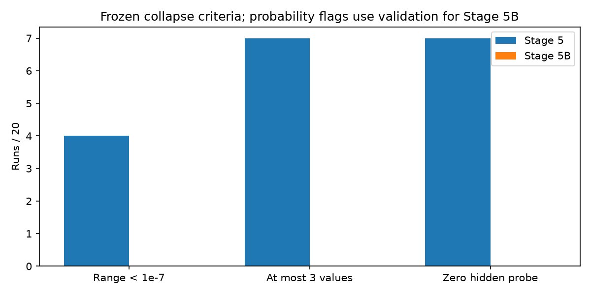
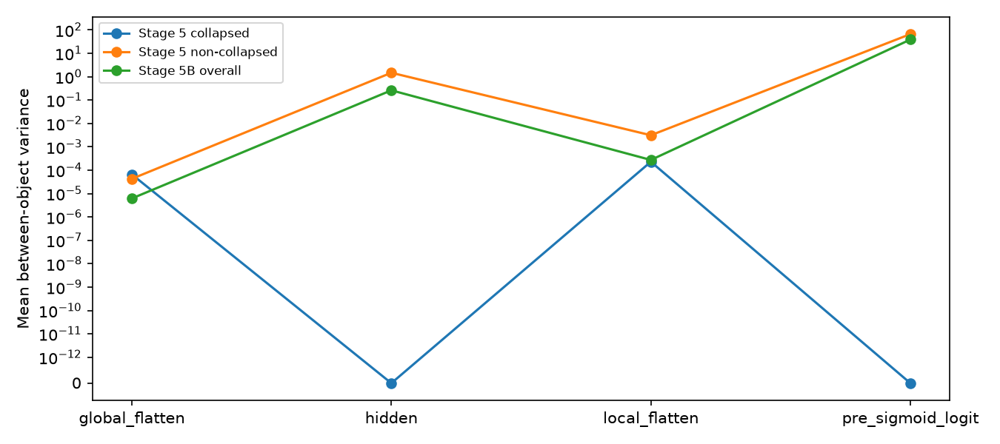
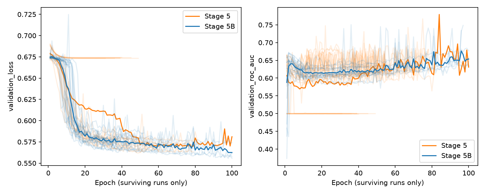
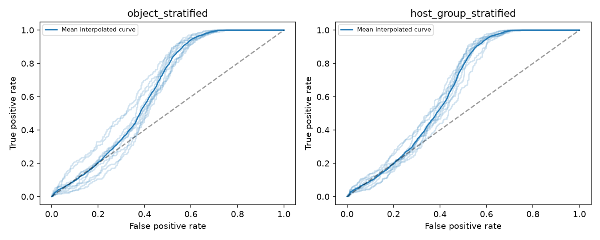
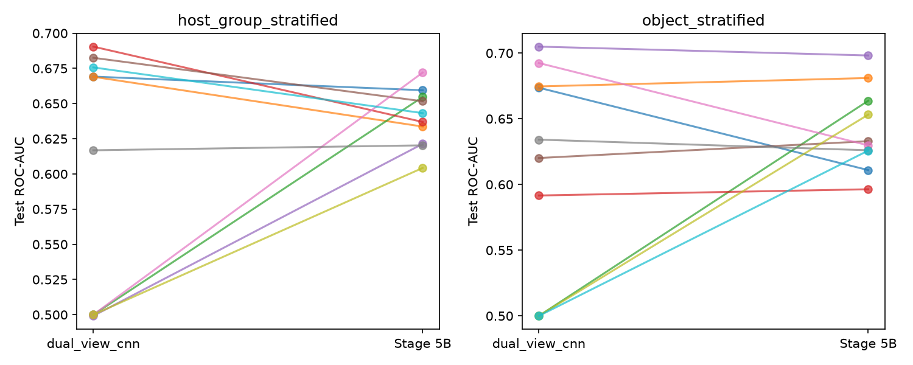
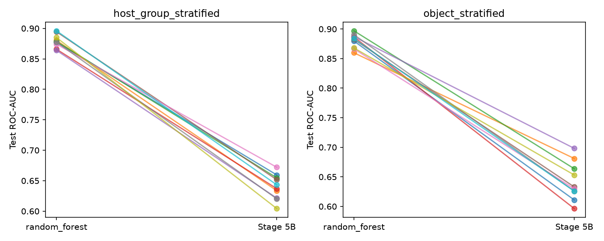
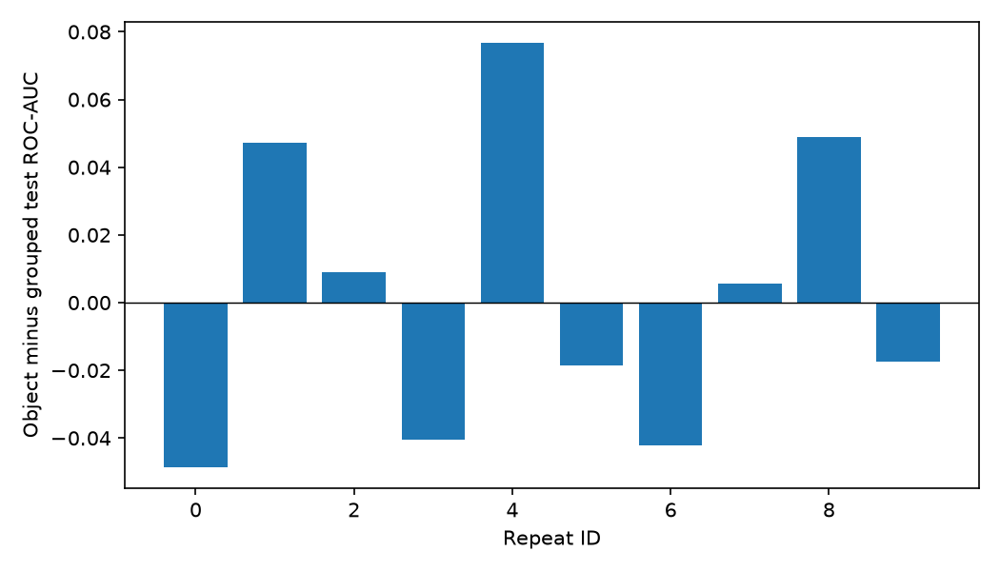
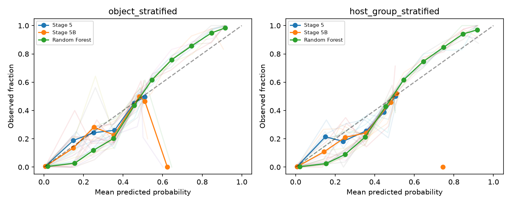

# Stage 5B: LeakyReLU fusion activation ablation

Status: **certified**. All 20 intended fits retained. No scientific fits executed during finalization.

## 1. Objective

Test whether replacing the fusion ReLU materially reduces the zero-representation collapse diagnosed in Stage 5A. This is one controlled activation ablation, not a search using test results.

## 2. Frozen change

`Dense(32, ReLU)` became `Dense(32, linear) -> LeakyReLU(negative_slope=0.01)`. AST comparison after reversing these two edits is identical to Stage 5. Configuration comparison preserves convolutional branches, filters (16/32), kernels (5), pooling (global 5/local 2), Flatten widths (2560/1600), Dense width 32, dropout 0.2, 138,561 parameters, Adam at 0.001, BCE, batch 64, maximum 100 epochs, patience 10, restore-best weights, no class/sample weighting, global clipnorm 1, threshold 0.5, seeds, splits, arrays, cohort and QC policy. Matched initialization hashes agree with Stage 5. Experiment identity and provenance/stability metadata are the other configuration differences.

## 3. Run integrity and timing

Exactly 2 strategies x 10 repeats; 20 models and prediction files, 132,740 prediction rows, 120 metric rows and 1,200 calibration rows. Completion receipts, runtime hashes, histories, identities and denominators passed. The nine pre-interruption fits remain byte-identical; no duplicate scientific outputs were created.

Completed fits total **16901.148 seconds** (4.695 hours), including per-fit evaluation/serialization. Recorded completed epoch time totals 16616.254 seconds. The last resumed process took 9257.929 seconds; it is not the experiment total. Exact total including the discarded, unfinished fit cannot be reconstructed from durable histories, so no complete all-attempt wall time is claimed.

## 4. Validation gate before test evaluation

Frozen gate SHA256 `55819dcc28d9f5b2dbb3ee7bf7dbba8d940d5ac4af2b73b953a2990555dd5ee6`. Log gate event: 2026-09-26T19:32:10.049815+00:00; first test event: 2026-09-26T19:32:10.080090+00:00. Each evaluation receipt binds to that gate. Stability and validation conclusions below use the pre-test records; subsequent test performance did not change the model or rules.

## 5. Collapse and validation stability

Stage 5B: **0/20 severe**, **0/20 at most three values**, **0/20 fully zero fusion probes**, **0/20 nonfinite runs**, and 4/20 epoch caps. Stage 5 had 4 severe and 7 low-diversity runs; all seven had fully zero fusion probes. These counts overlap and must not be added.

LeakyReLU eliminated the observed original fusion-layer collapse in all 20 runs. Stage 5A probability flags used the full cohort; the pre-test Stage 5B gate used validation only. A directly comparable full-cohort check gives 0 severe and 0 low-diversity Stage 5B runs, versus 4 and 7 for Stage 5.

| measurement | mean | median | std | min | max |
| --- | --- | --- | --- | --- | --- |
| validation_range | 0.5713958 | 0.5411602 | 0.08033226 | 0.5140314 | 0.8646398 |
| validation_std | 0.1866858 | 0.186538 | 0.008906186 | 0.1702867 | 0.2060074 |
| hidden_zero_fraction | 0 | 0 | 0 | 0 | 0 |
| hidden_variance | 0.2888845 | 0.2664455 | 0.1381247 | 0.1573866 | 0.7587859 |
| best_epoch | 58.55 | 48 | 25.61758 | 30 | 100 |
| stopping_epoch | 66.85 | 58 | 22.91696 | 40 | 100 |
| validation_bce | 0.5695096 | 0.5694489 | 0.008673708 | 0.5555497 | 0.5865797 |
| validation_roc_auc | 0.6314004 | 0.6320683 | 0.02223499 | 0.5898372 | 0.6822611 |

Validation BCE is the restored best-checkpoint BCE. Validation ROC-AUC is read from that same selected epoch, not the stopping epoch. Hidden variance here is the variance over all sampled objects and units; between-object variance appears next. Sample standard deviations across runs use ddof=1.

Pre-gate train/validation-only inference and post-gate full-cohort inference use different batch compositions. Their maximum probability difference is 1.1920929e-07, with 0 changed labels. These are not identical-context replay calls; no new equivalence tolerance is introduced. The frozen pre-gate records remain authoritative, while the fresh replay below uses the original full-cohort order and batch size and must satisfy the existing 1e-7 tolerance.

| strategy | validation_bce | stage5_validation_bce | validation_bce_minus_stage5 | validation_roc_auc | roc_auc | validation_auc_difference |
| --- | --- | --- | --- | --- | --- | --- |
| host_group_stratified | 0.56688 | 0.6100562 | -0.04317622 | 0.6335256 | 0.5963559 | 0.03716971 |
| object_stratified | 0.5721392 | 0.6024177 | -0.03027843 | 0.6292752 | 0.6019897 | 0.02728555 |

## 6. Activation findings

Same 128 training KOIs per run, selected by smallest SHA256(KOI), verified against the Stage 5A lists. All activations are inference-only with dropout disabled. Branch rows are Flatten representations; hidden is post-ReLU for Stage 5 and post-LeakyReLU for Stage 5B. Logits are measured before sigmoid, not reconstructed from rounded probabilities. `std` is over all probe entries; `between_object_variance` is mean feature-wise variance across objects, both computed in float64 with ddof=0. Group entries are unweighted means across runs. No new failure threshold is used.

| group | layer | mean | std | zero_fraction | between_object_variance | runs |
| --- | --- | --- | --- | --- | --- | --- |
| Stage 5 collapsed | global_flatten | 0.4621993 | 0.6468013 | 0.4957149 | 6.591537e-05 | 7 |
| Stage 5 collapsed | hidden | 0 | 0 | 1 | 0 | 7 |
| Stage 5 collapsed | local_flatten | 0.4499178 | 0.6989478 | 0.551363 | 0.0002287477 | 7 |
| Stage 5 collapsed | pre_sigmoid_logit | -0.3933758 | 0 | 0 | 0 | 7 |
| Stage 5 non-collapsed | global_flatten | 0.002329378 | 0.01603756 | 0.9890928 | 4.265469e-05 | 13 |
| Stage 5 non-collapsed | hidden | 0.1446582 | 1.239954 | 0.9451059 | 1.465916 | 13 |
| Stage 5 non-collapsed | local_flatten | 0.06269136 | 0.6073807 | 0.9286264 | 0.003115573 | 13 |
| Stage 5 non-collapsed | pre_sigmoid_logit | -2.754012 | 7.896369 | 0 | 65.96098 | 13 |
| Stage 5B overall | global_flatten | 0.0002723002 | 0.00254558 | 0.9952571 | 6.167302e-06 | 20 |
| Stage 5B overall | hidden | 0.152736 | 0.5260527 | 0 | 0.2599932 | 20 |
| Stage 5B overall | local_flatten | 0.01205459 | 0.1439686 | 0.9489111 | 0.0002733677 | 20 |
| Stage 5B overall | pre_sigmoid_logit | -2.155616 | 5.972814 | 0 | 38.5527 | 20 |

| group | probability_range_mean | probability_range_min | probability_range_max | probability_std_mean | probability_std_min | probability_std_max | unique_probability_count_mean | unique_probability_count_min | unique_probability_count_max |
| --- | --- | --- | --- | --- | --- | --- | --- | --- | --- |
| Stage 5 collapsed | 0.05834042 | 2.980232e-08 | 0.3983684 | 0.0007160624 | 3.657897e-10 | 0.004889519 | 2.428571 | 2 | 3 |
| Stage 5 non-collapsed | 0.5077973 | 0.483333 | 0.5265777 | 0.1895599 | 0.1765611 | 0.1975088 | 4006.692 | 1810 | 6556 |
| Stage 5B overall | 0.6240562 | 0.5570299 | 0.8646398 | 0.1870902 | 0.1761981 | 0.2015082 | 6545.6 | 6434 | 6604 |

History means at late epochs include only runs still training, and are descriptive rather than matched epoch effects.

## 7. Primary test performance

All ten repeats per strategy; no repeated observations pooled into a headline metric. Threshold remains 0.5. AP and trapezoidal PR-AUC are distinct. Confusion counts and prevalence use the original assigned test cohort.

| strategy | metric | count | mean | median | std | min | max | range |
| --- | --- | --- | --- | --- | --- | --- | --- | --- |
| host_group_stratified | accuracy | 10 | 0.6044172 | 0.6041247 | 0.02323364 | 0.5517588 | 0.6315261 | 0.07976731 |
| host_group_stratified | assigned_count | 10 | 994.5 | 994.5 | 1.080123 | 993 | 996 | 3 |
| host_group_stratified | average_precision | 10 | 0.4676613 | 0.4659564 | 0.02177521 | 0.4426957 | 0.5064365 | 0.0637408 |
| host_group_stratified | brier | 10 | 0.2021494 | 0.2025067 | 0.002631468 | 0.1985086 | 0.2063334 | 0.007824777 |
| host_group_stratified | f1 | 10 | 0.4321714 | 0.5764928 | 0.2801076 | 0.01960784 | 0.6708408 | 0.6512329 |
| host_group_stratified | fn | 10 | 184.4 | 127 | 155.6907 | 26 | 397 | 371 |
| host_group_stratified | fp | 10 | 209 | 255.5 | 146.9822 | 3 | 351 | 348 |
| host_group_stratified | negative_count | 10 | 594 | 594 | 0.6666667 | 593 | 595 | 2 |
| host_group_stratified | positive_count | 10 | 400.5 | 400.5 | 0.5270463 | 400 | 401 | 1 |
| host_group_stratified | positive_prevalence | 10 | 0.4027149 | 0.4027151 | 0.0002549215 | 0.4024145 | 0.4030151 | 0.0006005885 |
| host_group_stratified | pr_auc_trapezoidal | 10 | 0.4656992 | 0.4638987 | 0.02168282 | 0.4409208 | 0.5043354 | 0.06341457 |
| host_group_stratified | precision | 10 | 0.5197955 | 0.5153508 | 0.08519256 | 0.3846154 | 0.7142857 | 0.3296703 |
| host_group_stratified | qc_excluded_count | 10 | 0 | 0 | 0 | 0 | 0 | 0 |
| host_group_stratified | recall | 10 | 0.5394931 | 0.6827525 | 0.3889064 | 0.009975062 | 0.9351621 | 0.925187 |
| host_group_stratified | roc_auc | 10 | 0.6397753 | 0.6400906 | 0.02062268 | 0.6042854 | 0.6720581 | 0.06777267 |
| host_group_stratified | sample_count | 10 | 994.5 | 994.5 | 1.080123 | 993 | 996 | 3 |
| host_group_stratified | tn | 10 | 385 | 339 | 146.7871 | 243 | 591 | 348 |
| host_group_stratified | tp | 10 | 216.1 | 273.5 | 155.7851 | 4 | 375 | 371 |
| object_stratified | accuracy | 10 | 0.5925478 | 0.5996979 | 0.03371301 | 0.5337362 | 0.6354481 | 0.101712 |
| object_stratified | assigned_count | 10 | 993 | 993 | 0 | 993 | 993 | 0 |
| object_stratified | average_precision | 10 | 0.4694166 | 0.4619485 | 0.04036429 | 0.4149491 | 0.5367449 | 0.1217959 |
| object_stratified | brier | 10 | 0.2027096 | 0.2036346 | 0.003216467 | 0.1967438 | 0.2061492 | 0.009405447 |
| object_stratified | f1 | 10 | 0.2968872 | 0.2394636 | 0.274889 | 0.004950495 | 0.6604651 | 0.6555146 |
| object_stratified | fn | 10 | 265.6 | 319.5 | 144.9101 | 44 | 398 | 354 |
| object_stratified | fp | 10 | 139 | 136 | 132.1632 | 3 | 321 | 318 |
| object_stratified | negative_count | 10 | 594 | 594 | 0 | 594 | 594 | 0 |
| object_stratified | positive_count | 10 | 399 | 399 | 0 | 399 | 399 | 0 |
| object_stratified | positive_prevalence | 10 | 0.4018127 | 0.4018127 | 0 | 0.4018127 | 0.4018127 | 0 |
| object_stratified | pr_auc_trapezoidal | 10 | 0.4673051 | 0.4597052 | 0.04039334 | 0.4131373 | 0.5349208 | 0.1217836 |
| object_stratified | precision | 10 | 0.4607059 | 0.5171893 | 0.1459438 | 0.2 | 0.6111111 | 0.4111111 |
| object_stratified | qc_excluded_count | 10 | 0 | 0 | 0 | 0 | 0 | 0 |
| object_stratified | recall | 10 | 0.3343358 | 0.1992481 | 0.3631832 | 0.002506266 | 0.8897243 | 0.887218 |
| object_stratified | roc_auc | 10 | 0.6418032 | 0.6313669 | 0.03175088 | 0.5963668 | 0.6981912 | 0.1018244 |
| object_stratified | sample_count | 10 | 993 | 993 | 0 | 993 | 993 | 0 |
| object_stratified | tn | 10 | 455 | 458 | 132.1632 | 273 | 591 | 318 |
| object_stratified | tp | 10 | 133.4 | 79.5 | 144.9101 | 1 | 355 | 354 |

Full per-repeat metrics, counts and prevalence: [test_metrics.csv](../data/stage5b/test_metrics.csv).

Mean interpolated ROC curves are visual summaries only; headline AUC is the mean of ten run-specific AUCs.

## 8. Stage 5B versus frozen Stage 5

Differences are Stage 5B minus reference. Positive ROC-AUC/AP/F1/accuracy is better; **negative Brier is better**. Higher/lower/tied are literal numeric comparisons, not universal win/loss counts. All 20 matched comparisons are retained in [stage5_comparisons.csv](../data/stage5b/stage5_comparisons.csv).

| strategy | metric | count | mean | median | std | min | max | higher | lower | tied |
| --- | --- | --- | --- | --- | --- | --- | --- | --- | --- | --- |
| host_group_stratified | accuracy | 10 | -0.006038548 | -2.026256e-06 | 0.02530725 | -0.04522613 | 0.02409639 | 5 | 5 | 0 |
| host_group_stratified | average_precision | 10 | 0.008063867 | 0.001128273 | 0.05687619 | -0.05960641 | 0.104022 | 5 | 5 | 0 |
| host_group_stratified | brier | 10 | -0.01537448 | -0.001901084 | 0.01965319 | -0.04061205 | 0.001239551 | 4 | 6 | 0 |
| host_group_stratified | f1 | 10 | 0.1008939 | 0.04197527 | 0.4674744 | -0.6482655 | 0.6188679 | 7 | 3 | 0 |
| host_group_stratified | roc_auc | 10 | 0.03948518 | -0.003097632 | 0.08818943 | -0.0535299 | 0.1720581 | 5 | 5 | 0 |
| object_stratified | accuracy | 10 | -0.006042296 | -0.002014099 | 0.02315484 | -0.03927492 | 0.03423968 | 5 | 5 | 0 |
| object_stratified | average_precision | 10 | 0.007497131 | 0.002850084 | 0.05559427 | -0.0784003 | 0.09417522 | 7 | 3 | 0 |
| object_stratified | brier | 10 | -0.0111391 | -0.0001576984 | 0.01912008 | -0.0422694 | 0.003059161 | 4 | 6 | 0 |
| object_stratified | f1 | 10 | -0.001711618 | -0.01090799 | 0.4713545 | -0.6506051 | 0.6604651 | 5 | 5 | 0 |
| object_stratified | roc_auc | 10 | 0.03264538 | 0.005576863 | 0.08408963 | -0.06269883 | 0.1637364 | 6 | 4 | 0 |

## 9. Stage 5B versus Random Forest (principal baseline)

Differences are Stage 5B minus reference. Positive ROC-AUC/AP/F1/accuracy is better; **negative Brier is better**. Higher/lower/tied are literal numeric comparisons, not universal win/loss counts. All 20 matched comparisons are retained in [baseline_comparisons.csv](../data/stage5b/baseline_comparisons.csv).

| strategy | metric | count | mean | median | std | min | max | higher | lower | tied |
| --- | --- | --- | --- | --- | --- | --- | --- | --- | --- | --- |
| host_group_stratified | accuracy | 10 | -0.1854262 | -0.1798995 | 0.01494957 | -0.2140704 | -0.1696787 | 0 | 10 | 0 |
| host_group_stratified | average_precision | 10 | -0.340999 | -0.3425595 | 0.02574928 | -0.376541 | -0.2900292 | 0 | 10 | 0 |
| host_group_stratified | brier | 10 | 0.05568858 | 0.05478311 | 0.005006633 | 0.04940837 | 0.06419014 | 10 | 0 | 0 |
| host_group_stratified | f1 | 10 | -0.3123945 | -0.1607656 | 0.2764481 | -0.7201478 | -0.08657978 | 0 | 10 | 0 |
| host_group_stratified | roc_auc | 10 | -0.2395628 | -0.2427677 | 0.02234244 | -0.2807441 | -0.2021128 | 0 | 10 | 0 |
| object_stratified | accuracy | 10 | -0.1986908 | -0.1968781 | 0.0393682 | -0.265861 | -0.1450151 | 0 | 10 | 0 |
| object_stratified | average_precision | 10 | -0.3435761 | -0.3452876 | 0.04907666 | -0.3957193 | -0.2451444 | 0 | 10 | 0 |
| object_stratified | brier | 10 | 0.05678415 | 0.05865545 | 0.004383111 | 0.05045613 | 0.06239852 | 10 | 0 | 0 |
| object_stratified | f1 | 10 | -0.448083 | -0.5291214 | 0.2768117 | -0.7361816 | -0.07359024 | 0 | 10 | 0 |
| object_stratified | roc_auc | 10 | -0.2383927 | -0.2432249 | 0.03553062 | -0.290231 | -0.1788583 | 0 | 10 | 0 |

## 10. Stage 5B versus Logistic Regression (secondary baseline)

Differences are Stage 5B minus reference. Positive ROC-AUC/AP/F1/accuracy is better; **negative Brier is better**. Higher/lower/tied are literal numeric comparisons, not universal win/loss counts. All 20 matched comparisons are retained in [baseline_comparisons.csv](../data/stage5b/baseline_comparisons.csv).

| strategy | metric | count | mean | median | std | min | max | higher | lower | tied |
| --- | --- | --- | --- | --- | --- | --- | --- | --- | --- | --- |
| host_group_stratified | accuracy | 10 | -0.09060277 | -0.08253853 | 0.03273386 | -0.159799 | -0.05326633 | 0 | 10 | 0 |
| host_group_stratified | average_precision | 10 | -0.1166745 | -0.1167097 | 0.01940081 | -0.1519844 | -0.089309 | 0 | 10 | 0 |
| host_group_stratified | brier | 10 | -0.004903004 | -0.004551469 | 0.007177207 | -0.02116278 | 0.004352391 | 2 | 8 | 0 |
| host_group_stratified | f1 | 10 | -0.1985598 | -0.05735931 | 0.2828438 | -0.605996 | 0.04362185 | 4 | 6 | 0 |
| host_group_stratified | roc_auc | 10 | -0.1128906 | -0.1121127 | 0.01559614 | -0.1361936 | -0.08998337 | 0 | 10 | 0 |
| object_stratified | accuracy | 10 | -0.1022155 | -0.09667674 | 0.05257113 | -0.2024169 | 0.002014099 | 1 | 9 | 0 |
| object_stratified | average_precision | 10 | -0.1138787 | -0.1149695 | 0.03527193 | -0.1960071 | -0.07365416 | 0 | 10 | 0 |
| object_stratified | brier | 10 | -0.004807598 | -0.005193349 | 0.009175002 | -0.02209887 | 0.006712709 | 4 | 6 | 0 |
| object_stratified | f1 | 10 | -0.3332333 | -0.4137519 | 0.2969722 | -0.6213212 | 0.1267929 | 2 | 8 | 0 |
| object_stratified | roc_auc | 10 | -0.1100873 | -0.1112082 | 0.03048078 | -0.1801368 | -0.07255513 | 0 | 10 | 0 |

## 11. Object versus host-group split

Object minus grouped, paired by repeat ID. The ten seed-matched differences are descriptive; overlapping repeated test sets are not independent replications. A small difference is not equivalence, and changing the split changes training/test composition as well as host overlap, so this is not a pure causal host-leakage estimate.

| repeat_id | accuracy | average_precision | brier | f1 | roc_auc |
| --- | --- | --- | --- | --- | --- |
| 0 | -0.02354611 | -0.07374308 | 0.0007195334 | -0.6575606 | -0.04852944 |
| 1 | 0.006042296 | 0.07727661 | 0.002535319 | 0.01452785 | 0.04736771 |
| 2 | -0.0003961331 | 0.02240599 | -0.001772953 | 0.02989052 | 0.009018348 |
| 3 | -0.0642538 | -0.04893443 | 8.128263e-05 | 0.07076544 | -0.04057624 |
| 4 | 0.08368934 | 0.08000304 | -0.006755545 | 0.1714933 | 0.07680484 |
| 5 | -0.03233174 | -0.0001135675 | 0.007572023 | -0.6158467 | -0.01868113 |
| 6 | 0.03081733 | -0.0534278 | 0.002552026 | 0.1263475 | -0.04228499 |
| 7 | -0.069632 | -0.001135315 | 0.003886603 | -0.2603175 | 0.005703246 |
| 8 | -0.02920443 | 0.03159221 | -0.005473635 | -0.1923779 | 0.0488837 |
| 9 | -0.01987885 | -0.01637079 | 0.002257963 | -0.03976357 | -0.01742712 |

| metric | count | mean | median | std | min | max | higher | lower | tied |
| --- | --- | --- | --- | --- | --- | --- | --- | --- | --- |
| accuracy | 10 | -0.01186941 | -0.02171248 | 0.04522345 | -0.069632 | 0.08368934 | 3 | 7 | 0 |
| average_precision | 10 | 0.001755288 | -0.000624441 | 0.05249116 | -0.07374308 | 0.08000304 | 4 | 6 | 0 |
| brier | 10 | 0.0005602616 | 0.001488748 | 0.004302546 | -0.006755545 | 0.007572023 | 7 | 3 | 0 |
| f1 | 10 | -0.1352842 | -0.01261786 | 0.2956117 | -0.6575606 | 0.1714933 | 5 | 5 | 0 |
| roc_auc | 10 | 0.002027892 | -0.005861939 | 0.04352175 | -0.04852944 | 0.07680484 | 5 | 5 | 0 |

## 12. QC sensitivity

Same saved predictions, evaluation-only QC subset; no QC retraining. The full cohort has 6,637 KOIs, 6,354 QC-pass and 283 excluded. Per-repeat original denominator, excluded count, class counts and prevalence are retained in [qc_sensitivity.csv](../data/stage5b/qc_sensitivity.csv) and [test_metrics.csv](../data/stage5b/test_metrics.csv).

| strategy | track | metric | count | mean | median | std | min | max | range |
| --- | --- | --- | --- | --- | --- | --- | --- | --- | --- |
| host_group_stratified | primary | assigned_count | 10 | 994.5 | 994.5 | 1.080123 | 993 | 996 | 3 |
| host_group_stratified | primary | brier | 10 | 0.2021494 | 0.2025067 | 0.002631468 | 0.1985086 | 0.2063334 | 0.007824777 |
| host_group_stratified | primary | negative_count | 10 | 594 | 594 | 0.6666667 | 593 | 595 | 2 |
| host_group_stratified | primary | positive_count | 10 | 400.5 | 400.5 | 0.5270463 | 400 | 401 | 1 |
| host_group_stratified | primary | positive_prevalence | 10 | 0.4027149 | 0.4027151 | 0.0002549215 | 0.4024145 | 0.4030151 | 0.0006005885 |
| host_group_stratified | primary | qc_excluded_count | 10 | 0 | 0 | 0 | 0 | 0 | 0 |
| host_group_stratified | primary | roc_auc | 10 | 0.6397753 | 0.6400906 | 0.02062268 | 0.6042854 | 0.6720581 | 0.06777267 |
| host_group_stratified | primary | sample_count | 10 | 994.5 | 994.5 | 1.080123 | 993 | 996 | 3 |
| host_group_stratified | qc_pass | assigned_count | 10 | 994.5 | 994.5 | 1.080123 | 993 | 996 | 3 |
| host_group_stratified | qc_pass | brier | 10 | 0.2054946 | 0.2058551 | 0.002432347 | 0.2023424 | 0.2093676 | 0.007025226 |
| host_group_stratified | qc_pass | negative_count | 10 | 558.3 | 558 | 3.560587 | 552 | 564 | 12 |
| host_group_stratified | qc_pass | positive_count | 10 | 396.4 | 398 | 4.087923 | 386 | 400 | 14 |
| host_group_stratified | qc_pass | positive_prevalence | 10 | 0.4152034 | 0.415625 | 0.00236143 | 0.4102019 | 0.4189474 | 0.008745456 |
| host_group_stratified | qc_pass | qc_excluded_count | 10 | 39.8 | 40 | 6.52857 | 30 | 53 | 23 |
| host_group_stratified | qc_pass | roc_auc | 10 | 0.6285198 | 0.6276764 | 0.02139797 | 0.5983296 | 0.6637399 | 0.0654103 |
| host_group_stratified | qc_pass | sample_count | 10 | 954.7 | 955 | 6.429965 | 941 | 964 | 23 |
| object_stratified | primary | assigned_count | 10 | 993 | 993 | 0 | 993 | 993 | 0 |
| object_stratified | primary | brier | 10 | 0.2027096 | 0.2036346 | 0.003216467 | 0.1967438 | 0.2061492 | 0.009405447 |
| object_stratified | primary | negative_count | 10 | 594 | 594 | 0 | 594 | 594 | 0 |
| object_stratified | primary | positive_count | 10 | 399 | 399 | 0 | 399 | 399 | 0 |
| object_stratified | primary | positive_prevalence | 10 | 0.4018127 | 0.4018127 | 0 | 0.4018127 | 0.4018127 | 0 |
| object_stratified | primary | qc_excluded_count | 10 | 0 | 0 | 0 | 0 | 0 | 0 |
| object_stratified | primary | roc_auc | 10 | 0.6418032 | 0.6313669 | 0.03175088 | 0.5963668 | 0.6981912 | 0.1018244 |
| object_stratified | primary | sample_count | 10 | 993 | 993 | 0 | 993 | 993 | 0 |
| object_stratified | qc_pass | assigned_count | 10 | 993 | 993 | 0 | 993 | 993 | 0 |
| object_stratified | qc_pass | brier | 10 | 0.2061513 | 0.2071866 | 0.003007592 | 0.200644 | 0.2098761 | 0.009232038 |
| object_stratified | qc_pass | negative_count | 10 | 555.8 | 557.5 | 7.420692 | 544 | 566 | 22 |
| object_stratified | qc_pass | positive_count | 10 | 394.2 | 394 | 1.032796 | 393 | 396 | 3 |
| object_stratified | qc_pass | positive_prevalence | 10 | 0.41497 | 0.4144824 | 0.003484144 | 0.4104167 | 0.4206603 | 0.01024361 |
| object_stratified | qc_pass | qc_excluded_count | 10 | 43 | 41.5 | 7.195678 | 33 | 54 | 21 |
| object_stratified | qc_pass | roc_auc | 10 | 0.6312548 | 0.6226298 | 0.02984954 | 0.5930809 | 0.6855279 | 0.09244694 |
| object_stratified | qc_pass | sample_count | 10 | 950 | 951.5 | 7.195678 | 939 | 960 | 21 |

## 13. Calibration

Ten fixed equal-width probability bins, Brier on each repeat and track, no post-hoc calibration. Empty bins are undefined. Reliability figure averages each nonempty bin equally across repeats; faint curves retain run variability. Repeated KOIs are not treated as independent evidence. Lower Brier is better; improvement in ranking does not establish adequate calibration.

| strategy | track | metric | count | mean | median | std | min | max | range |
| --- | --- | --- | --- | --- | --- | --- | --- | --- | --- |
| host_group_stratified | primary | brier | 10 | 0.2021494 | 0.2025067 | 0.002631468 | 0.1985086 | 0.2063334 | 0.007824777 |
| host_group_stratified | qc_pass | brier | 10 | 0.2054946 | 0.2058551 | 0.002432347 | 0.2023424 | 0.2093676 | 0.007025226 |
| object_stratified | primary | brier | 10 | 0.2027096 | 0.2036346 | 0.003216467 | 0.1967438 | 0.2061492 | 0.009405447 |
| object_stratified | qc_pass | brier | 10 | 0.2061513 | 0.2071866 | 0.003007592 | 0.200644 | 0.2098761 | 0.009232038 |

## 14. Interpretation

A: collapse fixed and substantial predictive improvement; B: collapse fixed but prediction remains substantially below Random Forest; C: collapse reduced but persists; D: failure not materially changed. These are descriptive, not predeclared statistical decision thresholds. A and B can overlap: improved prediction need not approach Random Forest.

**Best-supported finding: B.** Stabilization is distinct from predictive improvement. The fixed intervention removed the observed endpoint zero-fusion failure, supporting a role for the original fusion activation under this training setup. Paired test differences quantify predictive change without dropping poor runs; the Random Forest deficit remains explicit. Negative-slope activation permits gradients/values on the negative side, but saved endpoint probes cannot prove the trajectory, exact onset, or a unique cause of the original failure. The ablation does not establish that other bottlenecks are absent.

## 15. Limitations and replay

One cohort, one fixed architecture and ten paired seeds; no independent external confirmation. Test sets overlap across repeats, so descriptive repeat variability is not an independent-sample confidence interval. Training probe covers 128 objects per run. Diagnostics do not reconstruct training trajectories. Stage 4A canonical/cache certification was reused with pinned hashes instead of downloading or re-auditing raw archives.

One fresh-process saved-model replay verified 20 models and 132,740 probabilities; maximum absolute difference 0, existing tolerance atol=1e-7, rtol=0. KOI ordering, labels, folds, QC, predictions, recomputed metrics/calibration and unchanged weights passed. No training was executed.

## 16. Next scientific question

With collapse stabilized, why does the fixed CNN still underperform the principal baseline? A separately authorized, predeclared training/validation-only investigation could test whether the near-flat branch representations and normalization preserve useful transit morphology. Retain Random Forest as the principal benchmark; reserve a new untouched evaluation plan before further model selection. No additional ablation or Stage 6 has been started.

## 17. Provenance, certification and artifact hashes

Parent Stage 5 commit: `4a2b193c7a1fc51eb3f721c03f75e78ff128d260`. Stage 1–5A scientific anchors verified unchanged; 174 parent tracked scientific files plus 321 frozen entries checked. Runtime model/prediction/history hashes: [runtime_checksums.sha256](../data/stage5b/runtime_checksums.sha256). Full compact output hashes: [checksums.sha256](../data/stage5b/checksums.sha256). Environment, seeds, deterministic settings, code and output hashes are recorded in provenance/certification.

17 historical text files have Git LF blobs and pre-existing CRLF checkout bytes; normalized content is identical and these files were not edited. All explicit scientific SHA256 anchors were checked byte-for-byte without normalization. Local protected-input byte hashes were captured before analysis and checked again at certification.

Offline suite: 162 passed, 0 skipped; network tests excluded. Focused Stage 5B tests passed. `git diff --check` passed. One Stage 5B commit is authorized only after these checks.

| artifact | sha256 |
| --- | --- |
| configs/kepler_stage5b_activation_v1.json | 68cfc2b4ada7d6ce04db8b189a146f13ee3c2155e49d6c249fefa5c1fcc70c56 |
| configs/kepler_stage5b_freeze_v1.json | 94417a3d06e0560dca0a0c4c2bb77eec577500785988bc91b78aa41e7051d8c4 |
| docs/kepler_stage5a_failure_analysis.md | 340efc6263146faf30f18a1c80e2271f7f55fd3920609924a82a6e43a4470dde |
| data/stage5b/run_integrity.json | 80f70f183684e2999db47c3445558d3394226bb72bdf60ea6a55180c75737945 |
| data/stage5b/prediction_verification.json | f1d17641433f2c585c2e4a5491a06be6a41c87a2eb4ca98535ed0eadbd2e3d34 |
| data/stage5b/validation_stability_summary.json | 55819dcc28d9f5b2dbb3ee7bf7dbba8d940d5ac4af2b73b953a2990555dd5ee6 |
| data/stage5b/metrics.csv | 24c6ac90bee76d04702b47201ef19e4046fbaf76d571cd9d6e2058caed919a52 |
| data/stage5b/runtime_checksums.sha256 | 6c36d2d8f77b09659464d1d72d67b2bf416d559f76db181570241560a12b1eef |
| data/stage5b/certification.json | 64163f330061c8eead188116683c0f1e0984fef7f419d0e86a2539d99b582aad |
| data/stage5b/provenance.json | 19c4f21a6ad9c530e72f08b2c3fc3e6bb11beccff3a22fd4e9a8cf0e42883cf0 |
