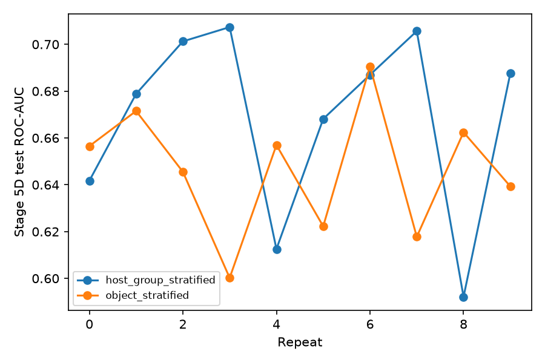
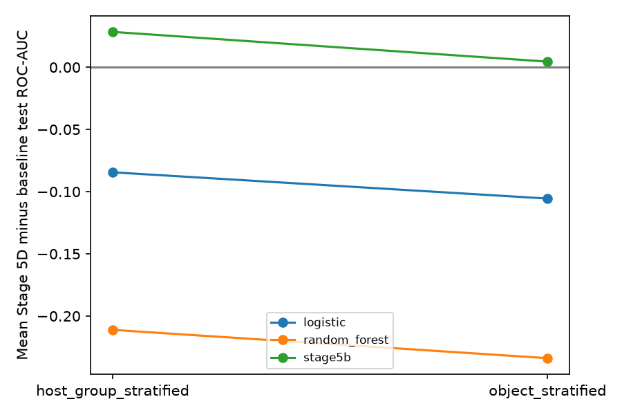
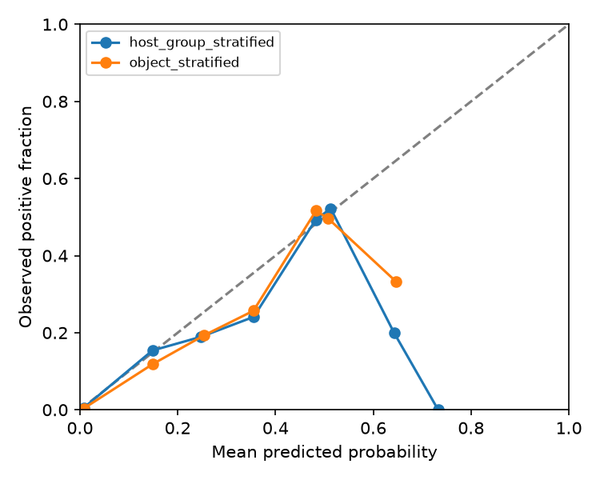

# Stage 5D — one-time frozen held-out evaluation

## Frozen protocol and integrity

Twenty predeclared models, two strategies × ten repeats; saved earliest-minimum-validation-BCE checkpoints, threshold 0.5. No fitting, tuning, recalibration, split change or test-based selection. pre_test_integrity.json pins every model, the Stage 3 splits, certified cache and prior tracked scientific artifacts before test feature selection. All subsequent inference uses only the matching frozen test rows. Primary track retains the complete assigned test population; QC-pass is a predefined sensitivity subset.

## Test performance

| strategy | track | metric | count | mean | median | sd | min | max |
| --- | --- | --- | --- | --- | --- | --- | --- | --- |
| host_group_stratified | primary | roc_auc | 10 | 0.668214 | 0.682896 | 0.040078 | 0.592129 | 0.707356 |
| host_group_stratified | primary | bce | 10 | 0.561733 | 0.560597 | 0.010507 | 0.547831 | 0.579381 |
| host_group_stratified | primary | average_precision | 10 | 0.502270 | 0.515969 | 0.037547 | 0.430831 | 0.542975 |
| host_group_stratified | primary | brier | 10 | 0.200790 | 0.199675 | 0.004097 | 0.195743 | 0.207957 |
| host_group_stratified | qc_pass | roc_auc | 10 | 0.658961 | 0.672193 | 0.040499 | 0.582736 | 0.699273 |
| host_group_stratified | qc_pass | bce | 10 | 0.570842 | 0.569927 | 0.009796 | 0.557668 | 0.588621 |
| host_group_stratified | qc_pass | average_precision | 10 | 0.509903 | 0.521103 | 0.038643 | 0.438644 | 0.554621 |
| host_group_stratified | qc_pass | brier | 10 | 0.204143 | 0.202941 | 0.003821 | 0.199202 | 0.211328 |
| object_stratified | primary | roc_auc | 10 | 0.646314 | 0.651016 | 0.027160 | 0.600234 | 0.690594 |
| object_stratified | primary | bce | 10 | 0.565675 | 0.564570 | 0.007754 | 0.555555 | 0.577264 |
| object_stratified | primary | average_precision | 10 | 0.475296 | 0.481426 | 0.031608 | 0.419728 | 0.520175 |
| object_stratified | primary | brier | 10 | 0.202174 | 0.201531 | 0.003018 | 0.198577 | 0.206777 |
| object_stratified | qc_pass | roc_auc | 10 | 0.635295 | 0.636299 | 0.027991 | 0.596682 | 0.683673 |
| object_stratified | qc_pass | bce | 10 | 0.574667 | 0.574109 | 0.007119 | 0.565712 | 0.587406 |
| object_stratified | qc_pass | average_precision | 10 | 0.481057 | 0.488108 | 0.030602 | 0.429919 | 0.527121 |
| object_stratified | qc_pass | brier | 10 | 0.205566 | 0.205170 | 0.002873 | 0.201811 | 0.210571 |

## Frozen matched comparisons

Deltas are Stage 5D minus baseline; lower Brier is better. Sample SD is across repeats; counts reverse the direction for Brier. All twenty individual pairs for five metrics and both tracks are preserved in the paired CSVs. Denominators and class counts are checked before joining. Random Forest is the principal benchmark; Logistic Regression supplies secondary context. Certified baseline metrics are reused without refitting or recomputation.

| baseline | strategy | track | metric | count | mean | median | sd | min | max | improved | worsened | tied |
| --- | --- | --- | --- | --- | --- | --- | --- | --- | --- | --- | --- | --- |
| stage5b | host_group_stratified | primary | accuracy | 10 | 0.013772 | 0.013562 | 0.019724 | -0.020141 | 0.045317 | 7 | 1 | 2 |
| stage5b | host_group_stratified | primary | average_precision | 10 | 0.034609 | 0.037199 | 0.040555 | -0.024435 | 0.099013 | 8 | 2 | 0 |
| stage5b | host_group_stratified | primary | brier | 10 | -0.001360 | -0.001776 | 0.002199 | -0.004700 | 0.001623 | 7 | 3 | 0 |
| stage5b | host_group_stratified | primary | f1 | 10 | 0.081114 | 0.016452 | 0.305823 | -0.513383 | 0.620628 | 7 | 3 | 0 |
| stage5b | host_group_stratified | primary | roc_auc | 10 | 0.028439 | 0.030428 | 0.035524 | -0.017784 | 0.085316 | 7 | 3 | 0 |
| stage5b | object_stratified | primary | accuracy | 10 | 0.003021 | 0.000504 | 0.028145 | -0.038268 | 0.061430 | 5 | 5 | 0 |
| stage5b | object_stratified | primary | average_precision | 10 | 0.005879 | -0.001869 | 0.038559 | -0.049165 | 0.074684 | 5 | 5 | 0 |
| stage5b | object_stratified | primary | brier | 10 | -0.000536 | 0.000042 | 0.002593 | -0.005472 | 0.003580 | 5 | 5 | 0 |
| stage5b | object_stratified | primary | f1 | 10 | 0.096671 | 0.014362 | 0.337338 | -0.608242 | 0.589143 | 6 | 4 | 0 |
| stage5b | object_stratified | primary | roc_auc | 10 | 0.004511 | -0.002194 | 0.030107 | -0.041208 | 0.060821 | 5 | 5 | 0 |
| stage5b | overall | primary | accuracy | 20 | 0.008397 | 0.006529 | 0.024289 | -0.038268 | 0.061430 | 12 | 6 | 2 |
| stage5b | overall | primary | average_precision | 20 | 0.020244 | 0.010003 | 0.041238 | -0.049165 | 0.099013 | 13 | 7 | 0 |
| stage5b | overall | primary | brier | 20 | -0.000948 | -0.000648 | 0.002378 | -0.005472 | 0.003580 | 12 | 8 | 0 |
| stage5b | overall | primary | f1 | 20 | 0.088893 | 0.016452 | 0.313481 | -0.608242 | 0.620628 | 13 | 7 | 0 |
| stage5b | overall | primary | roc_auc | 20 | 0.016475 | 0.011388 | 0.034319 | -0.041208 | 0.085316 | 12 | 8 | 0 |
| random_forest | host_group_stratified | primary | accuracy | 10 | -0.171654 | -0.169350 | 0.021528 | -0.222558 | -0.146586 | 0 | 10 | 0 |
| random_forest | host_group_stratified | primary | average_precision | 10 | -0.306390 | -0.306143 | 0.046401 | -0.388406 | -0.244103 | 0 | 10 | 0 |
| random_forest | host_group_stratified | primary | brier | 10 | 0.054329 | 0.052491 | 0.005857 | 0.047974 | 0.065461 | 0 | 10 | 0 |
| random_forest | host_group_stratified | primary | f1 | 10 | -0.231280 | -0.118903 | 0.231398 | -0.677319 | -0.078210 | 0 | 10 | 0 |
| random_forest | host_group_stratified | primary | roc_auc | 10 | -0.211124 | -0.205002 | 0.041196 | -0.292901 | -0.158514 | 0 | 10 | 0 |
| random_forest | object_stratified | primary | accuracy | 10 | -0.195670 | -0.203927 | 0.047132 | -0.273917 | -0.130916 | 0 | 10 | 0 |
| random_forest | object_stratified | primary | average_precision | 10 | -0.337697 | -0.344218 | 0.045870 | -0.397772 | -0.266634 | 0 | 10 | 0 |
| random_forest | object_stratified | primary | brier | 10 | 0.056249 | 0.057409 | 0.005968 | 0.046958 | 0.063066 | 0 | 10 | 0 |
| random_forest | object_stratified | primary | f1 | 10 | -0.351412 | -0.274363 | 0.277859 | -0.743280 | -0.076494 | 0 | 10 | 0 |
| random_forest | object_stratified | primary | roc_auc | 10 | -0.233881 | -0.237313 | 0.036097 | -0.286364 | -0.176025 | 0 | 10 | 0 |
| random_forest | overall | primary | accuracy | 20 | -0.183662 | -0.176884 | 0.037730 | -0.273917 | -0.130916 | 0 | 20 | 0 |
| random_forest | overall | primary | average_precision | 20 | -0.322044 | -0.327331 | 0.047691 | -0.397772 | -0.244103 | 0 | 20 | 0 |
| random_forest | overall | primary | brier | 20 | 0.055289 | 0.056008 | 0.005838 | 0.046958 | 0.065461 | 0 | 20 | 0 |
| random_forest | overall | primary | f1 | 20 | -0.291346 | -0.147556 | 0.256383 | -0.743280 | -0.076494 | 0 | 20 | 0 |
| random_forest | overall | primary | roc_auc | 20 | -0.222503 | -0.224809 | 0.039464 | -0.292901 | -0.158514 | 0 | 20 | 0 |
| logistic | host_group_stratified | primary | accuracy | 10 | -0.076830 | -0.076421 | 0.030755 | -0.127767 | -0.037149 | 0 | 10 | 0 |
| logistic | host_group_stratified | primary | average_precision | 10 | -0.082066 | -0.089396 | 0.042431 | -0.135304 | -0.006107 | 0 | 10 | 0 |
| logistic | host_group_stratified | primary | brier | 10 | -0.006263 | -0.005429 | 0.007579 | -0.024753 | 0.000911 | 8 | 2 | 0 |
| logistic | host_group_stratified | primary | f1 | 10 | -0.117445 | -0.012150 | 0.231949 | -0.588472 | 0.047375 | 5 | 5 | 0 |
| logistic | host_group_stratified | primary | roc_auc | 10 | -0.084452 | -0.080761 | 0.040704 | -0.145037 | -0.022907 | 0 | 10 | 0 |
| logistic | object_stratified | primary | accuracy | 10 | -0.099194 | -0.099698 | 0.054423 | -0.188318 | 0.016113 | 1 | 9 | 0 |
| logistic | object_stratified | primary | average_precision | 10 | -0.107999 | -0.110477 | 0.049471 | -0.191228 | -0.017769 | 0 | 10 | 0 |
| logistic | object_stratified | primary | brier | 10 | -0.005343 | -0.005438 | 0.010267 | -0.025570 | 0.008199 | 6 | 4 | 0 |
| logistic | object_stratified | primary | f1 | 10 | -0.236563 | -0.180495 | 0.292691 | -0.655182 | 0.123889 | 3 | 7 | 0 |
| logistic | object_stratified | primary | roc_auc | 10 | -0.105576 | -0.108932 | 0.044333 | -0.176270 | -0.011734 | 0 | 10 | 0 |
| logistic | overall | primary | accuracy | 20 | -0.088012 | -0.087570 | 0.044527 | -0.188318 | 0.016113 | 1 | 19 | 0 |
| logistic | overall | primary | average_precision | 20 | -0.095033 | -0.101962 | 0.046788 | -0.191228 | -0.006107 | 0 | 20 | 0 |
| logistic | overall | primary | brier | 20 | -0.005803 | -0.005429 | 0.008795 | -0.025570 | 0.008199 | 14 | 6 | 0 |
| logistic | overall | primary | f1 | 20 | -0.177004 | -0.031007 | 0.264193 | -0.655182 | 0.123889 | 8 | 12 | 0 |
| logistic | overall | primary | roc_auc | 20 | -0.095014 | -0.096539 | 0.042816 | -0.176270 | -0.011734 | 0 | 20 | 0 |

## Validation-to-test generalization

| strategy | validation_delta | test_delta | direction_reproduced | effect |
| --- | --- | --- | --- | --- |
| host_group_stratified | 0.030221 | 0.028439 | True | reduced |
| object_stratified | 0.003958 | 0.004511 | True | preserved/increased |
| overall | 0.017089 | 0.016475 | True | reduced |

## Object versus host-group

| metric | count | mean | median | sd | min | max | improved | worsened | tied |
| --- | --- | --- | --- | --- | --- | --- | --- | --- | --- |
| accuracy | 10 | -0.022621 | -0.026050 | 0.045214 | -0.100781 | 0.052367 | 3 | 7 | 0 |
| average_precision | 10 | -0.026974 | -0.016980 | 0.058395 | -0.118694 | 0.053102 | 3 | 7 | 0 |
| brier | 10 | 0.001385 | 0.001108 | 0.005621 | -0.007960 | 0.010064 | 5 | 5 | 0 |
| f1 | 10 | -0.119728 | -0.034279 | 0.331799 | -0.622894 | 0.517233 | 2 | 8 | 0 |
| roc_auc | 10 | -0.021900 | -0.026595 | 0.056905 | -0.107122 | 0.070301 | 4 | 6 | 0 |

The difference is descriptive: neither a small difference nor a reversed sign proves equivalence or identifies a pure causal host-leakage effect. Repeated partitions overlap; these SDs are descriptive rather than independent-sample uncertainty estimates.

## QC and calibration

| strategy | track | mean_denominator | mean_excluded | mean_prevalence | roc_auc | average_precision | brier | f1 | accuracy |
| --- | --- | --- | --- | --- | --- | --- | --- | --- | --- |
| host_group_stratified | primary | 994.500000 | 0.000000 | 0.402715 | 0.668214 | 0.502270 | 0.200790 | 0.513286 | 0.618190 |
| host_group_stratified | qc_pass | 954.700000 | 39.800000 | 0.415203 | 0.658961 | 0.509903 | 0.204143 | 0.517709 | 0.612065 |
| object_stratified | primary | 993.000000 | 0.000000 | 0.401813 | 0.646314 | 0.475296 | 0.202174 | 0.393558 | 0.595569 |
| object_stratified | qc_pass | 950.000000 | 43.000000 | 0.414970 | 0.635295 | 0.481057 | 0.205566 | 0.397155 | 0.586892 |

Per-repeat denominators, exclusions and prevalence are in qc_sensitivity.csv. Calibration uses ten fixed equal-width bins, with empty bins retained. The reliability figure pools bin counts across repeats per strategy (objects can recur); it is descriptive, not an independent-cohort calibration estimate. No calibration model is fitted.

## Representation diagnosis and scientific interpretation

Stage 5C correctly localized a major loss of fixed linear-probe discrimination at fusion. The hidden-probe AUC rose from 0.722274 to 0.826806, near the width128 concatenated AUC 0.829044. The signed concat-minus-hidden gap fell from 0.105972 to 0.002238, improving in 19/20 pairs (97.9% mean reduction). These frozen validation probes were not rerun and are a separability proxy, not information-theoretic information loss. Width128 fixed much of that probe-level loss; the following held-out comparison establishes how much translated into classification.

Interpretation category **B**. Object mean CNN AUC change: +0.004511; host-group: +0.028439; overall: +0.016475. Random Forest comparison: Stage 5D minus RF -0.222503. The fusion bottleneck was not established as the sole cause of CNN underperformance. Branches trained end-to-end, probe preservation does not guarantee a well-trained CNN output head, and repeated validation and baseline test reuse constrain independent confirmation. No new scientific adjustment follows from these test outcomes.

## Replay, certification and artifacts

prediction_verification.json records the single fresh-process replay of all twenty models: KOI/label/split order, saved probabilities, threshold labels, and metrics. Predictions, sample IDs, labels, QC flags and probabilities are preserved under the excluded data/stage5d_test_runtime/runs/ tree and bound by compact per-run completion receipts. certification.json and checksums.sha256 bind the compact results and checks. The evaluation cannot silently repeat: any started partial phase stops for review.

