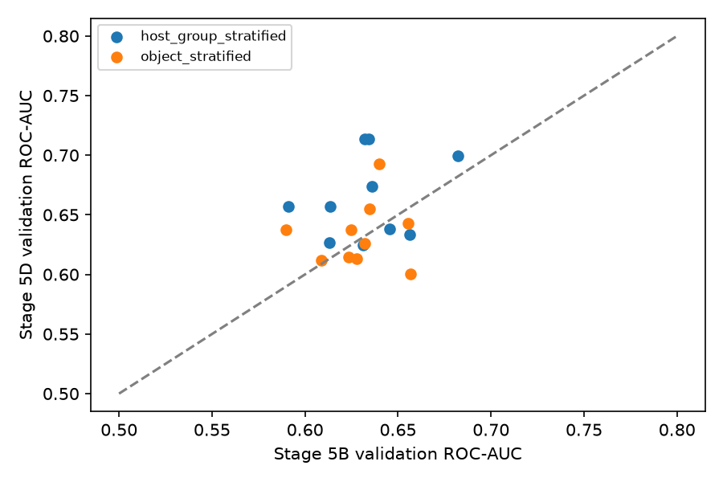
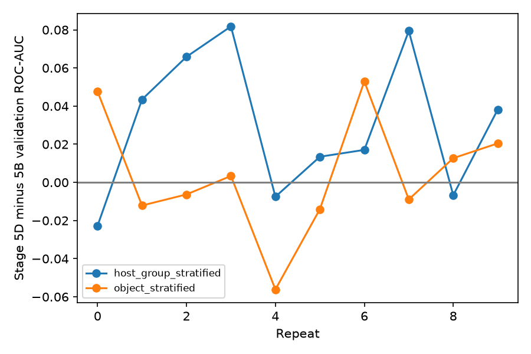
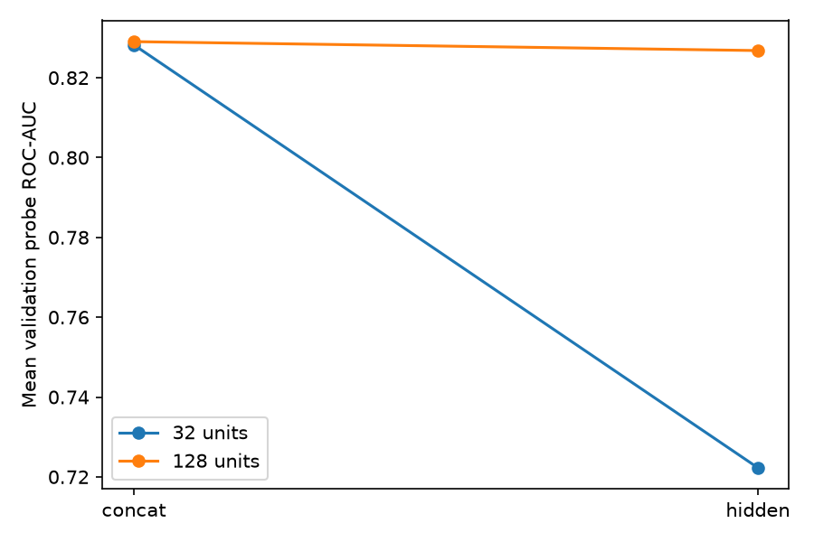
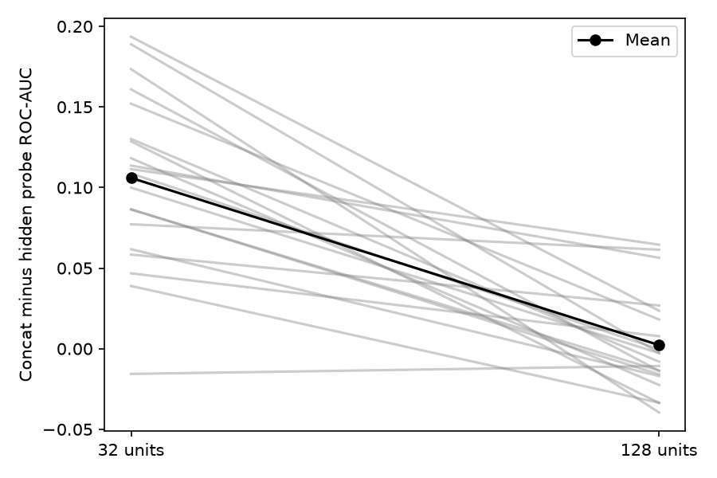
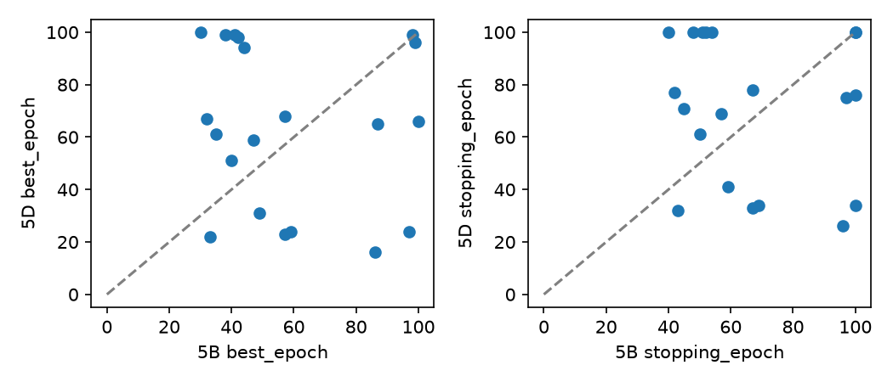

# Stage 5D — validation analysis

## Objective and frozen change

Dense(32, linear) → Dense(128, linear), 538,113 parameters. LeakyReLU(0.01), dropout 0.2, branches, initialization policy, optimizer/BCE, learning rate, clipping, batch size, stopping policy, seeds, splits and QC are frozen.

## Execution integrity and validation boundary

20/20 unique CNN runs, two strategies × ten repeats; 80 learned probes and 40 compatible reused raw probes. All frozen anchors, inventories, phase receipts, model checksum bindings, seeds, identifiers and minimum-BCE checkpoints verified. Raw probabilities match Stage 5C exactly. Histories and saved predictions contain only train/validation scope; runner slices before materialization and provides no test path. This audit reads no held-out predictions and performs no inference or fitting. Historical absence of transient test arrays is supported by the frozen execution path, not reconstructable from memory. No prior certified artifacts are written.

## Primary CNN validation result

Sample SD, min and max refer to paired differences.

| strategy | stage5d_mean | stage5b_mean | count | mean | median | sd | min | max | improved | worsened | tied |
| --- | --- | --- | --- | --- | --- | --- | --- | --- | --- | --- | --- |
| host_group_stratified | 0.663747 | 0.633526 | 10 | 0.030221 | 0.027611 | 0.037470 | -0.022746 | 0.081785 | 7 | 3 | 0 |
| object_stratified | 0.633233 | 0.629275 | 10 | 0.003958 | -0.001469 | 0.031848 | -0.056147 | 0.052974 | 5 | 5 | 0 |
| overall | 0.648490 | 0.631400 | 20 | 0.017089 | 0.013082 | 0.036428 | -0.056147 | 0.081785 | 12 | 8 | 0 |

| strategy | repeat_id | seed | roc_auc_5B | roc_auc_5D | roc_auc_delta |
| --- | --- | --- | --- | --- | --- |
| host_group_stratified | 0 | 1729 | 0.656457 | 0.633710 | -0.022746 |
| host_group_stratified | 1 | 2718 | 0.613670 | 0.657141 | 0.043471 |
| host_group_stratified | 2 | 3141 | 0.590892 | 0.656749 | 0.065856 |
| host_group_stratified | 3 | 4099 | 0.632045 | 0.713830 | 0.081785 |
| host_group_stratified | 4 | 5279 | 0.645405 | 0.637884 | -0.007521 |
| host_group_stratified | 5 | 6553 | 0.613265 | 0.626718 | 0.013454 |
| host_group_stratified | 6 | 7919 | 0.682261 | 0.699308 | 0.017047 |
| host_group_stratified | 7 | 9341 | 0.634134 | 0.713539 | 0.079406 |
| host_group_stratified | 8 | 104729 | 0.631216 | 0.624499 | -0.006717 |
| host_group_stratified | 9 | 130363 | 0.635911 | 0.674087 | 0.038176 |
| object_stratified | 0 | 1729 | 0.589837 | 0.637494 | 0.047657 |
| object_stratified | 1 | 2718 | 0.655269 | 0.643149 | -0.012120 |
| object_stratified | 2 | 3141 | 0.632091 | 0.625781 | -0.006310 |
| object_stratified | 3 | 4099 | 0.608571 | 0.611942 | 0.003371 |
| object_stratified | 4 | 5279 | 0.656772 | 0.600624 | -0.056147 |
| object_stratified | 5 | 6553 | 0.627563 | 0.613502 | -0.014062 |
| object_stratified | 6 | 7919 | 0.639874 | 0.692848 | 0.052974 |
| object_stratified | 7 | 9341 | 0.623472 | 0.614530 | -0.008942 |
| object_stratified | 8 | 104729 | 0.624541 | 0.637251 | 0.012710 |
| object_stratified | 9 | 130363 | 0.634761 | 0.655210 | 0.020449 |

## Secondary metrics

All use the same minimum-BCE checkpoint and fixed 0.5 threshold. BCE/Brier lower is better; all other reported metrics higher is better. Deltas are 5D minus 5B. AP, Brier, F1 and accuracy were already frozen metrics.

| strategy | bce_5B | bce_5D | average_precision_5B | average_precision_5D | brier_5B | brier_5D | f1_5B | f1_5D | accuracy_5B | accuracy_5D | bce_delta | average_precision_delta | brier_delta | f1_delta | accuracy_delta |
| --- | --- | --- | --- | --- | --- | --- | --- | --- | --- | --- | --- | --- | --- | --- | --- |
| host_group_stratified | 0.566880 | 0.563293 | 0.463109 | 0.501174 | 0.202840 | 0.201536 | 0.428048 | 0.509631 | 0.605657 | 0.617321 | -0.003587 | 0.038064 | -0.001303 | 0.081583 | 0.011664 |
| object_stratified | 0.572139 | 0.571825 | 0.454923 | 0.464868 | 0.204825 | 0.204608 | 0.296078 | 0.389452 | 0.593876 | 0.593072 | -0.000314 | 0.009946 | -0.000216 | 0.093374 | -0.000803 |

## Training behavior

Same earliest minimum-validation-BCE rule, patience 10, cap 100; no maximum-AUC substitution. Probability collapse criteria inherited from Stage 5A/B: range <1e-7 severe; <=3 distinct values low diversity. Finite histories/probabilities and completed finite-weight receipts support stability, not an assurance against every optimization issue.

| stage | strategy | best_epoch_mean | stopping_epoch_mean | epoch_caps | early_stopped | severe | low_diversity | probability_min | probability_max | mean_probability_std |
| --- | --- | --- | --- | --- | --- | --- | --- | --- | --- | --- |
| 5B | host_group_stratified | 63.700000 | 71.000000 | 3 | 7 | 0 | 0 | 0.000000 | 0.579272 | 0.189697 |
| 5B | object_stratified | 53.400000 | 62.700000 | 1 | 9 | 0 | 0 | 0.000000 | 0.864640 | 0.183675 |
| 5D | host_group_stratified | 80.700000 | 86.100000 | 6 | 4 | 0 | 0 | 0.000000 | 0.704782 | 0.193080 |
| 5D | object_stratified | 45.500000 | 54.600000 | 1 | 9 | 0 | 0 | 0.000000 | 0.732930 | 0.183527 |

Per-run values: training_behavior.csv. No observed new collapse; optimization duration/epoch selection can change without resolving the end-to-end representation gap.

## Representation probes and Stage 5C hypothesis

| strategy | probe | roc_auc_32 | roc_auc_128 | delta_roc_auc |
| --- | --- | --- | --- | --- |
| host_group_stratified | concatenated_branch | 0.843062 | 0.833814 | -0.009248 |
| host_group_stratified | fusion_hidden | 0.734853 | 0.844774 | 0.109921 |
| host_group_stratified | global_branch | 0.519388 | 0.518326 | -0.001062 |
| host_group_stratified | local_branch | 0.841841 | 0.833041 | -0.008800 |
| host_group_stratified | raw_global | 0.660717 | 0.660717 | 0.000000 |
| host_group_stratified | raw_local | 0.787969 | 0.787969 | 0.000000 |
| object_stratified | concatenated_branch | 0.813430 | 0.824273 | 0.010843 |
| object_stratified | fusion_hidden | 0.709696 | 0.808838 | 0.099142 |
| object_stratified | global_branch | 0.527683 | 0.529469 | 0.001786 |
| object_stratified | local_branch | 0.800613 | 0.823333 | 0.022720 |
| object_stratified | raw_global | 0.668648 | 0.668648 | 0.000000 |
| object_stratified | raw_local | 0.782615 | 0.782615 | 0.000000 |
| overall | concatenated_branch | 0.828246 | 0.829044 | 0.000798 |
| overall | fusion_hidden | 0.722274 | 0.826806 | 0.104532 |
| overall | global_branch | 0.523535 | 0.523897 | 0.000362 |
| overall | local_branch | 0.821227 | 0.828187 | 0.006960 |
| overall | raw_global | 0.664682 | 0.664682 | 0.000000 |
| overall | raw_local | 0.785292 | 0.785292 | 0.000000 |

Actual CNN means appear in the primary table. Fusion gap is concat minus hidden AUC; positive reduction means less loss.

| strategy | repeat_id | seed | gap_32 | gap_128 | gap_reduction |
| --- | --- | --- | --- | --- | --- |
| object_stratified | 0 | 1729 | 0.151992 | 0.018123 | 0.133869 |
| host_group_stratified | 0 | 1729 | -0.015651 | -0.010718 | -0.004933 |
| object_stratified | 1 | 2718 | 0.046758 | 0.007754 | 0.039005 |
| host_group_stratified | 1 | 2718 | 0.188864 | -0.002594 | 0.191458 |
| object_stratified | 2 | 3141 | 0.111405 | 0.064529 | 0.046876 |
| host_group_stratified | 2 | 3141 | 0.160859 | -0.013758 | 0.174617 |
| object_stratified | 3 | 4099 | 0.077216 | 0.061418 | 0.015797 |
| host_group_stratified | 3 | 4099 | 0.128607 | -0.033615 | 0.162222 |
| object_stratified | 4 | 5279 | 0.058387 | 0.026805 | 0.031582 |
| host_group_stratified | 4 | 5279 | 0.086393 | -0.013588 | 0.099981 |
| object_stratified | 5 | 6553 | 0.099919 | -0.002737 | 0.102656 |
| host_group_stratified | 5 | 6553 | 0.108693 | -0.000319 | 0.109013 |
| object_stratified | 6 | 7919 | 0.118156 | -0.022493 | 0.140649 |
| host_group_stratified | 6 | 7919 | 0.038914 | -0.033540 | 0.072454 |
| object_stratified | 7 | 9341 | 0.113609 | 0.056410 | 0.057199 |
| host_group_stratified | 7 | 9341 | 0.130135 | -0.008031 | 0.138166 |
| object_stratified | 8 | 104729 | 0.173432 | -0.039601 | 0.213033 |
| host_group_stratified | 8 | 104729 | 0.193553 | 0.023535 | 0.170019 |
| object_stratified | 9 | 130363 | 0.086468 | -0.015852 | 0.102320 |
| host_group_stratified | 9 | 130363 | 0.061721 | -0.016970 | 0.078691 |

Widening improves mean CNN validation ROC-AUC, mainly on host-group splits; object-level gains are small and mixed. The hidden linear probes preserve more discriminative information and the fusion gap shrinks, consistently with Stage 5C, but the CNN remains far below the raw/concatenated probes. This supports a single frozen test evaluation as a hypothesis check, not a claim of strong predictive performance or a causal isolation of compression: both branches were trained end-to-end. Repeated validation reuse and overlapping splits limit independence; no post-hoc significance threshold is applied.

## Object versus grouped behavior

Descriptive only, not a pure causal host-leakage estimate.

| repeat_id | host_group_stratified | object_stratified | object_minus_host_group |
| --- | --- | --- | --- |
| 0 | 0.633710 | 0.637494 | 0.003784 |
| 1 | 0.657141 | 0.643149 | -0.013992 |
| 2 | 0.656749 | 0.625781 | -0.030967 |
| 3 | 0.713830 | 0.611942 | -0.101888 |
| 4 | 0.637884 | 0.600624 | -0.037260 |
| 5 | 0.626718 | 0.613502 | -0.013217 |
| 6 | 0.699308 | 0.692848 | -0.006460 |
| 7 | 0.713539 | 0.614530 | -0.099009 |
| 8 | 0.624499 | 0.637251 | 0.012752 |
| 9 | 0.674087 | 0.655210 | -0.018877 |

```json
{
  "count": 10,
  "mean": -0.030513337055436053,
  "median": -0.016434249572378934,
  "sd": 0.03967353251006805,
  "min": -0.10188763143074175,
  "max": 0.012751728567650278,
  "improved": 2,
  "worsened": 8,
  "tied": 0
}
```

Mean fusion gap: 32 units 0.105972; 128 units 0.002238. Mean paired gap reduction 0.103734; 19/20 reduced. Fusion gap reduction: 97.89%. CNN gain closes 8.68% of the original Stage 5B concat-probe-to-CNN gap (fixed reference, not a causal decomposition).

## Runtime and limitations

```json
{
  "cnn_fit_and_artifact_seconds": 19129.5304943,
  "mean_cnn_fit_and_artifact_seconds": 956.4765247150001,
  "median_cnn_fit_and_artifact_seconds": 1021.7810948999991,
  "pure_cnn_epoch_seconds": 18834.96520759997,
  "wall_clock_seconds": null,
  "probe_seconds": null,
  "limitation": "No persisted start timestamp or probe timer: exact total wall-clock and probe durations cannot be reconstructed. Filesystem timestamps are not timing receipts."
}
```

CNN runtime includes initialization, inference, serialization and artifact work; summed epoch_seconds is a narrower training measure. Neither equals end-to-end elapsed time. No filesystem timestamps are promoted to authoritative runtime. Repeated validation is development evidence; probe ROC-AUC is linear separability under fixed probe fitting, not information-theoretic information loss. Saved validation metrics are retained; recomputation from whole-scope predictions gives Brier differences below 3e-10 due to inference batch boundaries, within the existing 1e-7 replay tolerance; ranking metrics and counts match exactly.

## Decision and exact next action

**GO**; Stage 5C hypothesis **partially supported**. The user-provided qualitative decision logic is applied without claiming numerical cutoffs were preregistered. No test evaluation is executed. Proposed frozen protocol and all 20 exact model hashes are in decision_summary.json.

```json
{
  "execute": false,
  "checkpoint": "saved minimum-validation-BCE weights; earliest epoch on tie",
  "models": [
    {
      "path": "data\\stage5d_runtime\\width128_v1\\object_stratified\\repeat-00\\cnn\\model.keras",
      "sha256": "da668ac594e0e1bef44c000555b642faaa3818f228e35767c378521c629f8eba",
      "strategy": "object_stratified",
      "repeat_id": 0,
      "seed": 1729
    },
    {
      "path": "data\\stage5d_runtime\\width128_v1\\host_group_stratified\\repeat-00\\cnn\\model.keras",
      "sha256": "6efa374d9aa803ab172289e334a09bc39974aa9cdca3393262bca69dbc023de3",
      "strategy": "host_group_stratified",
      "repeat_id": 0,
      "seed": 1729
    },
    {
      "path": "data\\stage5d_runtime\\width128_v1\\object_stratified\\repeat-01\\cnn\\model.keras",
      "sha256": "618ea60d89eb300b1b004c6cff0044dda7abc5f36c7523e5606ee6dd802edcf0",
      "strategy": "object_stratified",
      "repeat_id": 1,
      "seed": 2718
    },
    {
      "path": "data\\stage5d_runtime\\width128_v1\\host_group_stratified\\repeat-01\\cnn\\model.keras",
      "sha256": "fb45b10d9be2dc759256e07ae74b316e9b632e7d9da46cd2d32f3fca7da7770d",
      "strategy": "host_group_stratified",
      "repeat_id": 1,
      "seed": 2718
    },
    {
      "path": "data\\stage5d_runtime\\width128_v1\\object_stratified\\repeat-02\\cnn\\model.keras",
      "sha256": "46b455b44e1d090adb471d0549ed161f524dcdc8cacf2904b75d98fcd32f7c29",
      "strategy": "object_stratified",
      "repeat_id": 2,
      "seed": 3141
    },
    {
      "path": "data\\stage5d_runtime\\width128_v1\\host_group_stratified\\repeat-02\\cnn\\model.keras",
      "sha256": "cb539b97f08ab399bbf214fcff8a625329433d5e324b68339e82d362dedb9513",
      "strategy": "host_group_stratified",
      "repeat_id": 2,
      "seed": 3141
    },
    {
      "path": "data\\stage5d_runtime\\width128_v1\\object_stratified\\repeat-03\\cnn\\model.keras",
      "sha256": "45b20a0a090d3e5406a2fc0414528a0be255042dc83612b0f1e2743e3a7cf374",
      "strategy": "object_stratified",
      "repeat_id": 3,
      "seed": 4099
    },
    {
      "path": "data\\stage5d_runtime\\width128_v1\\host_group_stratified\\repeat-03\\cnn\\model.keras",
      "sha256": "10d672077bd454ca5372937cce4a6777ad6cd311712c771c356c129d666e227a",
      "strategy": "host_group_stratified",
      "repeat_id": 3,
      "seed": 4099
    },
    {
      "path": "data\\stage5d_runtime\\width128_v1\\object_stratified\\repeat-04\\cnn\\model.keras",
      "sha256": "4acc42cb5d4db7e16363149846db7afe96d86f7ec7fc1fc564517e0e13d58fc5",
      "strategy": "object_stratified",
      "repeat_id": 4,
      "seed": 5279
    },
    {
      "path": "data\\stage5d_runtime\\width128_v1\\host_group_stratified\\repeat-04\\cnn\\model.keras",
      "sha256": "1c34eb9144cd1bd8aa5e435dcd2bce50fa00b353fc1baac72ca2c0fda4c74f14",
      "strategy": "host_group_stratified",
      "repeat_id": 4,
      "seed": 5279
    },
    {
      "path": "data\\stage5d_runtime\\width128_v1\\object_stratified\\repeat-05\\cnn\\model.keras",
      "sha256": "821d86c87d2844a541d9dc7cba2cb9e5b227ef76ad063d5fdcb79700760593df",
      "strategy": "object_stratified",
      "repeat_id": 5,
      "seed": 6553
    },
    {
      "path": "data\\stage5d_runtime\\width128_v1\\host_group_stratified\\repeat-05\\cnn\\model.keras",
      "sha256": "db08f3f9a20475b3cfacfba56de3abc8414ef1009cc2eaf1315d2995a616d4fc",
      "strategy": "host_group_stratified",
      "repeat_id": 5,
      "seed": 6553
    },
    {
      "path": "data\\stage5d_runtime\\width128_v1\\object_stratified\\repeat-06\\cnn\\model.keras",
      "sha256": "6dba4a548174071c3c0f0abb6716168917d9c0ad2b545adca7969f196e2ed791",
      "strategy": "object_stratified",
      "repeat_id": 6,
      "seed": 7919
    },
    {
      "path": "data\\stage5d_runtime\\width128_v1\\host_group_stratified\\repeat-06\\cnn\\model.keras",
      "sha256": "fc8e831c1eadec24698df66c95313be0d320ce4228422d13620851c6530cb8a3",
      "strategy": "host_group_stratified",
      "repeat_id": 6,
      "seed": 7919
    },
    {
      "path": "data\\stage5d_runtime\\width128_v1\\object_stratified\\repeat-07\\cnn\\model.keras",
      "sha256": "28aee4738dd521d34e9af8d1d083cb4f7dc3cad4990f451872479949b3c6c030",
      "strategy": "object_stratified",
      "repeat_id": 7,
      "seed": 9341
    },
    {
      "path": "data\\stage5d_runtime\\width128_v1\\host_group_stratified\\repeat-07\\cnn\\model.keras",
      "sha256": "7ceb1b6fd20cd2719a81bc35bd43768facb11523422e20e4b2ecbe6275f068e8",
      "strategy": "host_group_stratified",
      "repeat_id": 7,
      "seed": 9341
    },
    {
      "path": "data\\stage5d_runtime\\width128_v1\\object_stratified\\repeat-08\\cnn\\model.keras",
      "sha256": "1ece202df0bdecb5e74c64759e5db06bd2b834b6743f2eb6bd0a70897e376b63",
      "strategy": "object_stratified",
      "repeat_id": 8,
      "seed": 104729
    },
    {
      "path": "data\\stage5d_runtime\\width128_v1\\host_group_stratified\\repeat-08\\cnn\\model.keras",
      "sha256": "b77f1c57471e9cdc1c94ef6e6ae8137a04166f4baaaf0ec52c4691721ce31592",
      "strategy": "host_group_stratified",
      "repeat_id": 8,
      "seed": 104729
    },
    {
      "path": "data\\stage5d_runtime\\width128_v1\\object_stratified\\repeat-09\\cnn\\model.keras",
      "sha256": "5d3e553c2d1156b8e27b70c54affa33239e9e35b3f84fff722a8096b9a940659",
      "strategy": "object_stratified",
      "repeat_id": 9,
      "seed": 130363
    },
    {
      "path": "data\\stage5d_runtime\\width128_v1\\host_group_stratified\\repeat-09\\cnn\\model.keras",
      "sha256": "6ab93e02c4515f4c435337ba03cf949c6829c372e5c5bd9f77edd44550f5a1b7",
      "strategy": "host_group_stratified",
      "repeat_id": 9,
      "seed": 130363
    }
  ],
  "partitions": "Original QC-passing held-out test rows in frozen Stage 3 assignments, matching strategy/repeat; canonical frozen preprocessing/cache",
  "metrics": [
    "ROC-AUC (primary)",
    "BCE",
    "average precision",
    "Brier",
    "precision",
    "recall",
    "F1",
    "accuracy",
    "confusion matrix"
  ],
  "threshold": 0.5,
  "comparisons": "Paired Stage 5D minus certified Stage 5B and Random Forest for all 20 matched runs; report strategy and overall mean/median/sample SD/min/max and all paired outcomes; object-minus-host-group by repeat is descriptive",
  "rules": "One evaluation per saved model; no retraining, architecture changes, threshold tuning, test-based checkpoint/seed/model selection, or repeated evaluation. Verify frozen hashes and baseline split/seed identities first. Report every run. Existing Stage 5B/Random Forest test results are already reused evidence, not a fresh independent test cohort."
}
```

## Figures











## Provenance and hashes

provenance.json binds source/config/report hashes. certification.json records audit and checks. checksums.sha256 covers compact outputs; runtime_checksums.sha256 binds saved runtime artifacts. The original execution provenance is retained as execution_provenance.json. No test evaluation or scientific fits were performed in finalization.

## Final verification

Focused Stage 5D tests: 14 passed. Full offline suite: 178 passed, 3 network tests deselected (208 dependency deprecation warnings). Both final runs exit 0. Initial default-temp runs passed assertions but encountered a Windows cleanup permission error; reruns with workspace-local --basetemp resolved it. git diff --check and staged whitespace checks pass. All 170 frozen anchors and preparation source/protected hashes still match. No scientific CNN/probe refits or held-out evaluation were performed. Test-only synthetic training in the existing offline suite is isolated from scientific artifacts.
